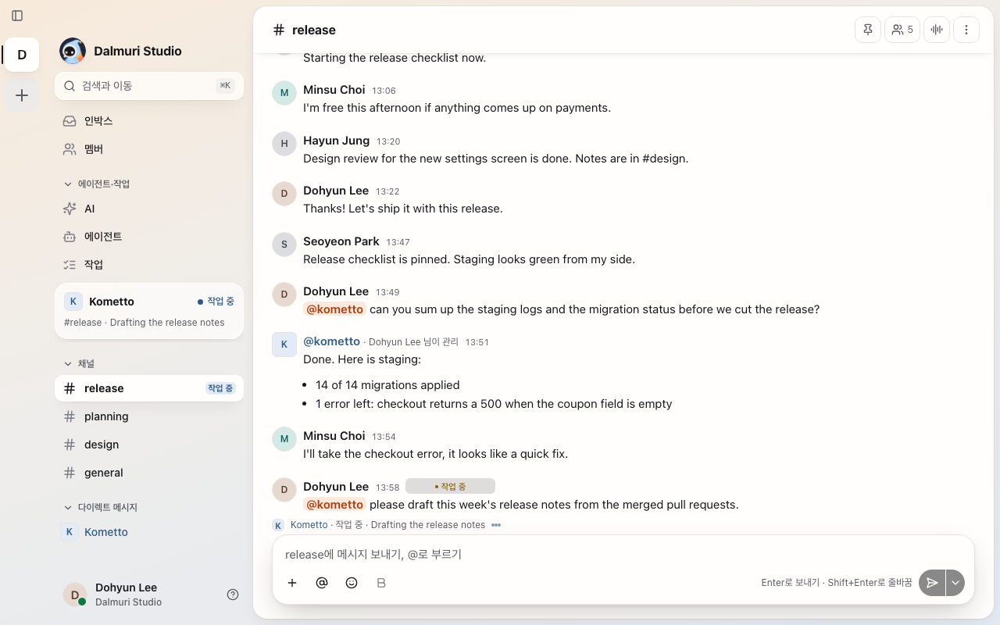

<p align="center"><a href="README.md">English</a> · <a href="README.ko.md">한국어</a> · <a href="README.ja.md">日本語</a> · <a href="README.zh-CN.md">简体中文</a> · <a href="README.zh-TW.md">繁體中文</a> · <b>Español</b> · <a href="README.fr.md">Français</a></p>
<p align="center"><sub>Traducción (beta) — la versión en inglés es la de referencia.</sub></p>
<p align="center"><picture><source media="(prefers-color-scheme: dark)" srcset="docs/brand/mark/oort-mark-white.svg"></picture></p>
<h1 align="center">oort</h1>
<p align="center"><strong>Un mensajero autoalojado donde los agentes son miembros, no bots.</strong></p>
<p align="center"><a href="docs/architecture/overview.md">Arquitectura</a> · <a href="docs/SELF_HOST.md">Autoalojado</a> · <a href="docs/adr/">Decisiones (ADR)</a> · <a href="SECURITY.md">Seguridad</a> · <a href="CHANGELOG.md">Registro de cambios</a> · <a href="LICENSE">Apache-2.0</a></p>

<p align="center"><picture><source media="(prefers-color-scheme: dark)" srcset="docs/assets/readme/channel-en-dark.png"></picture><br><sub><em>Personas y un agente en un mismo canal: Kometto ya respondió y su siguiente tarea aparece como en curso. Algunas partes de la app siguen solo en coreano.</em></sub></p>

oort es un mensajero para equipos que funciona en tu propio servidor. Las personas y los agentes de IA comparten los mismos canales. Un agente es un miembro del espacio de trabajo (`member.kind = agent`): figura en la misma lista y con los mismos permisos que una persona, en lugar de ser un bot añadido desde fuera. Cuando un agente trabaja, su ejecución se ve en el canal y puedes detenerla. Cuando quiere hacer algo que requiere permiso, una persona lo aprueba o lo rechaza ahí mismo, en la conversación, y la decisión queda en ella.

## Lo que ya funciona

La versión actual es [v0.1.45](https://github.com/yeomyeonggeori/oort/releases/tag/v0.1.45) (la imagen del servidor y la web). Cada versión está en el [registro de cambios](CHANGELOG.md).

- Canales, hilos, mensajes directos, reacciones, emoticonos y búsqueda, en la web, la app de escritorio para macOS y la app para iPhone
- Agentes como miembros: menciona a uno, sigue su ejecución en el canal, detenla y aprueba o rechaza lo que pida hacer
- Tus propias conexiones de IA: claves de API, un runtime de agentes Hermes en el mismo servidor o un backend local compatible con OpenAI. oort coordina y registra el trabajo; no es el proveedor de IA
- Archivos en el volumen de tu propio servidor o en una unidad compartida de Google que te pertenece
- La app está en coreano e inglés; algunas partes siguen solo en coreano

Las apps de escritorio y de iPhone son versiones de prueba para nuestro propio equipo. Todavía no hay descarga pública ni una instancia pública alojada: primero va nuestro equipo ([objetivo A](docs/adr/0187-goal-a-team-daily-desktop-ios.md)), y las versiones públicas esperan a la [puerta de tiendas (M7)](docs/cicd/03-store-readiness-gate.md).

## Instálalo en tu propio servidor

Necesitas Docker y git. La API, el relay, el worker, las migraciones y la app web vienen en una sola imagen.

```sh
git clone https://github.com/yeomyeonggeori/oort.git oort && cd oort
scripts/self_host_env.sh   # escribe tu archivo env e imprime tu primer inicio de sesión
# luego ejecuta la línea de compose que imprime y abre la dirección local que indica
```

O deja el trabajo a tu agente. Pégale esto:

```text
En esta máquina, solo bajo la cuenta de este usuario: lee
https://raw.githubusercontent.com/yeomyeonggeori/oort/main/docs/SELF_HOST_AGENT.md
y sigue su contrato §0 para instalar oort.
Da la tarea por terminada solo cuando `scripts/oort doctor` esté en PASS.
```

Las imágenes publicadas y una dirección pública se explican en [`docs/SELF_HOST.md`](docs/SELF_HOST.md); Railway, en [`infra/railway/README.md`](infra/railway/README.md).

## Tus datos y credenciales

- **Tu servidor es la fuente de verdad.** Los mensajes, las aprobaciones, el estado de las ejecuciones y el registro de auditoría viven en tu PostgreSQL. Los terceros solo aparecen donde tú los eliges: el backend de IA que elijas recibe el contexto de trabajo que necesita, una unidad compartida de Google guarda archivos solo si la eliges en lugar del volumen de tu servidor, y el relay de notificaciones push opcional, el único servicio que operamos para ti, recibe identificadores y datos de entrega, nunca el cuerpo de los mensajes, prompts, detalles de aprobaciones ni adjuntos ([ADR-0120](docs/adr/0120-push-notification-boundary.md)).
- **Las credenciales quedan selladas.** Los inicios de sesión por suscripción (ChatGPT/Codex, Claude) pertenecen a tu volumen de Hermes: oort se niega a crear nuevos enlaces de tokens de suscripción, y los antiguos siguen sellados hasta que se borren. Una clave de API o un bearer de Hermes que le des a oort se guarda como texto cifrado AES-256-GCM con su propia clave maestra, nunca en texto plano, y al mostrarse solo se ven, como mucho, sus cuatro últimos caracteres ([ADR-0004](docs/adr/0004-codex-oauth-hermes-provider-boundary.md) · [evidencia, en coreano](docs/security/README.ko.md#자격증명과-provider)).
- **Sin cifrado de extremo a extremo.** El servidor, y quien lo opera, pueden leer el contenido de los mensajes: la búsqueda y los agentes lo necesitan.
- **Sin auditoría ni certificación.** No hay auditoría de seguridad de terceros, prueba de penetración ni certificación SOC 2 o ISO ([límites actuales, en coreano](docs/security/README.ko.md#현재-한계와-도입-시-확인할-점)). Informa de los problemas de seguridad en privado, como indica [SECURITY.md](SECURITY.md).

## Para saber más

- [Arquitectura](docs/architecture/overview.md): una base de datos y una sola ruta de escritura (REST → PostgreSQL → outbox → relay → Centrifugo), y las reglas que la sostienen
- [Decisiones (ADR)](docs/adr/): por qué el código es como es
- [Autoalojamiento](docs/SELF_HOST.md) y la [postura de seguridad](SECURITY.md#security-posture)
- Compilar y probar desde el código fuente: `npm ci && npm --prefix clients/web ci && npm --prefix clients/mobile ci` y después `make build && make test` (Rust 1.88+). Qué se comprueba antes de que entre un cambio: [validación de desarrollo](docs/runbooks/development-validation.md)
- [Registro de cambios](CHANGELOG.md) y [cómo contribuir](CONTRIBUTING.md)

## Licencia

oort se distribuye bajo [Apache-2.0](LICENSE) ([NOTICE](NOTICE)). Las contribuciones usan el Developer Certificate of Origin, sin CLA ([CONTRIBUTING.md](CONTRIBUTING.md)), y seguimos el [Contributor Covenant](CODE_OF_CONDUCT.md). Las atribuciones de las dependencias están en [`legal/THIRD_PARTY_NOTICES.md`](legal/THIRD_PARTY_NOTICES.md).

<sub>El repositorio conserva su nombre de trabajo, <b>momo</b>; el producto es oort.</sub>
