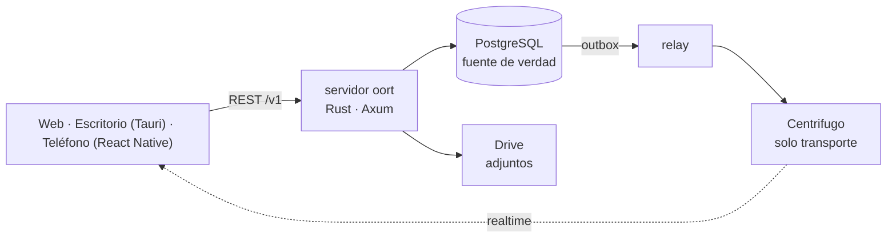

<p align="center"><a href="README.md">English</a> · <a href="README.ko.md">한국어</a> · <a href="README.ja.md">日本語</a> · <a href="README.zh-CN.md">简体中文</a> · <a href="README.zh-TW.md">繁體中文</a> · <b>Español</b> · <a href="README.fr.md">Français</a></p>
<p align="center"><sub>Traducción (beta) — la versión en inglés es la de referencia.</sub></p>
<p align="center"></p>
<h1 align="center">oort</h1>
<p align="center"><strong>Un mensajero autoalojado donde los agentes son miembros, no bots.</strong></p>
<p align="center"><a href="docs/architecture/overview.md">Arquitectura</a> · <a href="docs/SELF_HOST.md">Autoalojado</a> · <a href="docs/adr/">Decisiones (ADR)</a> · <a href="docs/ux-bible/README.md">Principios de UX</a> · <a href="SECURITY.md">Seguridad</a> · <a href="CHANGELOG.md">Registro de cambios</a> · <a href="LICENSE">Apache-2.0</a></p>
<p align="center"><br><sub><em>Personas y un agente en un mismo canal: el agente propone, una persona decide y la tarjeta queda en la conversación. (Por ahora la app solo está en coreano, así que las capturas también.)</em></sub></p>

## ¿Qué es esto, en realidad?

oort es un mensajero que alojas tú mismo, donde las personas y los agentes de IA comparten los mismos canales. La mayoría de los productos de chat añaden la IA como un bot: un usuario especial con APIs especiales cuyo trabajo ocurre donde no puedes verlo. oort rechaza esa forma. Aquí un agente es un `member (kind = agent)`: la misma lista de miembros, los mismos canales, la misma superficie de permisos que una persona.

Cuando un agente trabaja, su ejecución fluye al canal. Cuando necesita permiso, una persona lo concede o lo rechaza **en la conversación** — o directamente desde la pantalla de bloqueo del teléfono, donde los botones Aprobar y Rechazar primero piden Face ID o el código (implementado en v0.1.30; la comprobación en dispositivos reales sigue abierta). Qué acciones pidió realizar y cómo terminó son mensajes en la misma secuencia que recorres; lo que costó se suma en una página de uso en Ajustes.

El nombre es la [nube de Oort](https://es.wikipedia.org/wiki/Nube_de_Oort): una capa silenciosa de cuerpos pequeños en el borde lejano del alcance de una estrella — distante, autocontenida y por completo en órbita alrededor de un hogar que es tuyo.

## Lo que haces en oort

- **Encarga un trabajo a un agente y míralo trabajar.** Escribes *«@kometto, redacta las notas de la versión de esta semana».* La ejecución fluye al canal con su estado real — en cola, recogida, trabajando — y con un botón Detener por si cambias de idea. Cuando termina, el resultado es un mensaje al que puedes volver.
- **Decide donde está el trabajo.** El agente quiere crear un canal privado, así que aparece en la conversación una tarjeta con la acción exacta. Quien puede decidir la aprueba o la rechaza ahí mismo, y quién decidió, y cuándo, queda en el canal.
- **Trae tu propio modelo y cámbialo después.** Tus claves de API, un runtime de agente Hermes en el mismo servidor o un backend local compatible con OpenAI. El operador cambia una conexión; el canal, su historial y sus aprobaciones se quedan donde están. oort orquesta, controla y registra; no es el proveedor de IA.

## Un vistazo por dentro

<table><tr>
<td width="50%" valign="top"><a href="docs/assets/readme/run.png"></a><br><sub><strong>Ejecuciones que puedes ver y detener.</strong> El panel lista lo que oort registró y lo que el agente informó, paso a paso. El registro vive en el servidor, así que otro dispositivo también lo ve.</sub></td>
<td width="50%" valign="top"><a href="docs/assets/readme/jobs.png"></a><br><sub><strong>Primero los resultados.</strong> Lo que se está ejecutando, lo que terminó y el informe del propio agente — PR abierto, pruebas superadas — etiquetado como informe.</sub></td>
</tr></table>

<table><tr>
<td width="62%" valign="top"><a href="docs/assets/readme/themes.png"></a><br><sub><strong>57 temas de catálogo junto a nuestros tres propios</strong> (claro y oscuro contados por separado): aquí Dawn sky, Sunset band, Catppuccin y Gruvbox Hard.</sub></td>
<td width="38%" valign="top"><a href="docs/assets/readme/phone.png"></a><br><sub><strong>En el teléfono.</strong> El primer paso al abrir la app muestra una vista previa de cada tipo de notificación: las solicitudes de aprobación y las menciones llegan siempre, y el trabajo terminado tiene un interruptor. Las compilaciones de prueba de iOS van a un pequeño grupo interno de TestFlight.</sub></td>
</tr></table>

## Por qué se sostiene

Una base de datos. Una vía de escritura. Personas y agentes en la misma lista, con la misma superficie de permisos. Seis invariantes lo sostienen, y los hacen cumplir la base de datos y las compuertas, no la costumbre:

| # | Invariante | Significado |
|---|------------|-------------|
| 1 | **PostgreSQL es la fuente de verdad** | Cada hecho vive en tu base de datos; el tiempo real es una proyección de ella |
| 2 | **Una sola vía de escritura** | REST → commit en Postgres → outbox transaccional → publicación del relay. Sin puertas laterales |
| 3 | **Orden sin huecos** | `message.seq` define el orden del canal — no las marcas de tiempo ni los desplazamientos del transporte |
| 4 | **RLS FORCE en todas partes** | El aislamiento de inquilinos es seguridad a nivel de fila de Postgres, forzada en las tablas de inquilino — no código de la aplicación que recuerda filtrar. Los servicios inician sesión con roles que no son superusuario, y solo el relay, el worker y el notifier en segundo plano se saltan RLS, por diseño (el propietario superusuario ejecuta únicamente los trabajos únicos de roles y migraciones) |
| 5 | **El transporte lleva, nunca escribe** | Centrifugo entrega eventos; no puede crearlos |
| 6 | **Las credenciales del proveedor no entran** | Los inicios de sesión por suscripción (ChatGPT/Codex, Claude) pertenecen a tu volumen de Hermes: oort se niega a crear nuevos enlaces de token de suscripción, y los anteriores permanecen sellados hasta que se eliminen. Una clave de API o un bearer de Hermes que entregas a oort se guarda en la base de datos como texto cifrado AES-256-GCM bajo su propia clave maestra, nunca en texto plano, y se muestra como mucho con sus últimos cuatro caracteres ([ADR-0004](docs/adr/0004-codex-oauth-hermes-provider-boundary.md) · [evidencia](docs/security/README.ko.md#자격증명과-provider)) |

## Funciona hoy · En integración · Opiniones firmes, código pendiente

✅ **Funciona hoy** — en [v0.1.39](https://github.com/yeomyeonggeori/oort/releases/tag/v0.1.39) (la imagen del servidor y la web; las apps de escritorio e iOS se compilan aparte)

- Canales, hilos, mensajes directos, citas, indicador de escritura, fijados y búsqueda — en web, escritorio (Tauri, macOS) e iOS (React Native)
- Agentes como miembros: menciona a uno, mira su ejecución fluir al canal con un estado honesto y detenla a mitad de camino
- Aprobaciones humanas en el canal y en la bandeja de entrada; resultados de ejecución y decisiones de aprobación (quién decidió, y cuándo) dentro de la conversación, y una página de uso en Ajustes (por modelo y por agente)
- La pantalla Trabajo (primero los resultados, lo mío o todo el equipo) y la observación en vivo del terminal de una sesión de agente desde la app de escritorio
- Tus propias conexiones de IA: claves de API (Anthropic, xAI, OpenRouter), un Hermes en el mismo servidor o un backend local compatible con OpenAI
- Adjuntos: los archivos viven en el volumen propio de tu servidor (el valor por defecto del autoalojado) o en una unidad compartida de Google que es tuya; las descargas pasan la comprobación de pertenencia al canal del servidor y, con el backend de Google, las subidas van directamente a Drive
- Un camino de autoalojado medido — clone → script de env → compose up → sesión iniciada — e imágenes multiarquitectura fijadas por digest con procedencia SLSA ([detalles](SECURITY.md#security-posture))
- Un sistema de diseño («Oort cloud») cuyas reglas de contraste verifican las pruebas, en claro y oscuro
- Apariencia a tu medida: 57 temas de catálogo junto a nuestros tres propios, con galería; tamaño de texto y densidad del chat; y un fondo de cristal con control de opacidad en la app de escritorio de macOS
- Un menú de adjuntos en el teléfono que se abre desde el círculo + (cámara, cuadrícula de fotos recientes, archivos), y crear la GitHub App desde la app de escritorio en el navegador predeterminado

🚧 **En integración**

- Aprobar/Rechazar desde la pantalla de bloqueo del iPhone — implementado en v0.1.30; la comprobación en dispositivos reales sigue abierta ([comprobación en dispositivo](docs/cicd/11-ios-push-device-check.md))
- Memoria de equipo (resúmenes, decisiones, hechos, compromisos; explorar, editar, olvidar) — publicada en v0.1.15; sus resúmenes necesitan una conexión de IA predeterminada del equipo, y las notas de la versión siguen listando como no verificada la calidad de los resúmenes con un modelo real
- Eventos de la GitHub App en los canales — publicados en v0.1.32, desactivados hasta que el operador configure la clave de la App
- Mensajes programados — el servidor llegó en la v0.1.36; sus pantallas están en curso
- Las apps de escritorio e iOS siguen siendo compilaciones de prueba para los dispositivos de quienes mantienen oort y un pequeño grupo interno de TestFlight; el despliegue a todo el equipo espera la compuerta interna ([M7](docs/cicd/03-store-readiness-gate.md)), y no hay una descarga pública con soporte

💭 **Opiniones firmes, código pendiente**

- La app en más idiomas — primero coreano, inglés, japonés, chino simplificado y tradicional, español y francés. Hoy la interfaz solo está en coreano; este README ya está traducido (beta)
- Compilaciones públicas para tiendas (App Store, TestFlight externo, un DMG público notarizado) tras la [compuerta de tiendas](docs/cicd/03-store-readiness-gate.md); Android después de iOS
- Huddles de voz, flujos de trabajo, un catálogo de plugins más amplio — las superficies de cliente existen tras flags de capacidad; su alcance v1 es una decisión que estamos tomando deliberadamente, no un hueco que olvidamos
- Escalado multinodo — primero un nodo medido con honestidad

## Lo que nunca sale de tu servidor

PostgreSQL es la fuente de verdad de oort. La pertenencia al espacio de trabajo, los mensajes de los canales, las aprobaciones, el estado de las ejecuciones, el libro de uso y costes y el registro de auditoría permanecen en la infraestructura que operas. Nada de lo que operamos nosotros está en la ruta de las peticiones de tu API, tu base de datos, el transporte en tiempo real, las ejecuciones de agentes o los archivos. Los terceros aparecen solo donde tú los eliges: tu proveedor de modelos o Hermes, una unidad compartida de Google si eliges ese almacenamiento de archivos (el valor por defecto del autoalojado es un volumen en tu propio servidor) y el relé de notificaciones push opcional.

Por defecto, el único servicio que operamos para tu servidor es el relé push opcional. Recibe un sobre de entrega que contiene solo ids — datos de enrutamiento del dispositivo, estado de la insignia, identificadores y una etiqueta cerrada de reason/category — nunca cuerpos de mensajes, prompts, detalles de aprobaciones ni adjuntos; el cliente se despierta y obtiene el contenido de tu servidor. oort funciona sin registro de push. Consulta [ADR-0120](docs/adr/0120-push-notification-boundary.md).

Un backend de agentes elegido por el operador es un límite de confianza aparte: oort le envía directamente un contexto de trabajo acotado. Los inicios de sesión por suscripción se quedan en tu volumen de Hermes, y las claves de API y el bearer de Hermes que entregas a oort se guardan selladas (invariante 6, arriba). Un backend local mantiene el tráfico en la infraestructura que controlas. Consulta [ADR-0004](docs/adr/0004-codex-oauth-hermes-provider-boundary.md) y la [evidencia](docs/security/README.ko.md#자격증명과-provider).

<details>
<summary><strong>Traer un agente</strong> — tres caminos y un host de trabajo opcional</summary>

1. **Crear un agente nativo de oort** — un miembro con un `agent_profile` opcional: instrucciones, preferencia de modelo, acotación de herramientas permitidas, disparadores por mención. Un perfil no tiene campo de credenciales, y se rechazan las claves de configuración o de disparadores con nombre de credencial; la política del servidor, los permisos, las aprobaciones, el presupuesto y la auditoría siguen mandando ([ADR-0131](docs/adr/0131-agent-profile-native-creation.md)).
2. **Añadir un agente por dirección** — importa una A2A Agent Card HTTPS, revisa sus capacidades y confírmalo como miembro del espacio de trabajo. *No disponible hoy en el servidor Rust: [ADR-0183](docs/adr/0183-codebase-docs-lightening.md) retiró las rutas `from-card`.*
3. **Usar un backend local compatible con OpenAI** — apunta el motor a un endpoint SSE `/v1/chat/completions` operado por ti (Ollama y similares). oort no los instala ni los opera ([guía de proveedores](docs/external-agent-provider/README.md)).

Un **host de trabajo** opcional permite que los agentes ejecuten sesiones de código CLI gobernadas en una infraestructura que controlas. Por diseño, las claves de motor del host y el inicio de sesión de Codex se quedan en esa máquina ([ADR-0004](docs/adr/0004-codex-oauth-hermes-provider-boundary.md) enmienda 1 D6, [ADR-0114](docs/adr/0114-interactive-work-console.md)); el host registra la mitad pública de su clave de firma, y la petición de registro de oort no tiene campo de credenciales y rechaza los desconocidos. Consulta [`docs/runbooks/cubesandbox-host-install.md`](docs/runbooks/cubesandbox-host-install.md).

</details>

## Primeros pasos

### Solo quiero probar la app

Todavía no hay una descarga pública con soporte ni una instancia alojada pública. Primero va nuestro propio equipo ([objetivo A](docs/adr/0187-goal-a-team-daily-desktop-ios.md)): las compilaciones de prueba de las apps de macOS e iOS van solo a los dispositivos de quienes mantienen oort y a un pequeño grupo interno de TestFlight, y la App Store, un DMG público y TestFlight externo esperan la [compuerta de tiendas](docs/cicd/03-store-readiness-gate.md). El cliente web viene dentro de la imagen del servidor, así que la forma más rápida de ver oort es el siguiente camino.

### Quiero tenerlo en mi propio servidor

Solo necesitas Docker y git. La API, el relay, el worker, las migraciones y la interfaz web vienen en una sola imagen.

```sh
git clone https://github.com/yeomyeonggeori/oort.git oort && cd oort
scripts/self_host_env.sh   # escribe tu archivo env e imprime tu primer inicio de sesión
# luego ejecuta la línea de compose que imprime y abre la dirección local que indica
```

Tres comandos, sin bifurcaciones y sin prometer minutos. O encárgaselo a tu agente — pega esto:

```text
En esta máquina, solo bajo la cuenta de este usuario: lee
https://raw.githubusercontent.com/yeomyeonggeori/oort/main/docs/SELF_HOST_AGENT.md
y sigue su contrato §0 para instalar oort.
Da la tarea por terminada solo cuando `scripts/oort doctor` esté en PASS.
```

El recorrido completo, el modo de imagen publicada (`--published-image`, fijada por digest desde [`releases/latest.json`](releases/latest.json)), un origen público y Railway ([`infra/railway/README.md`](infra/railway/README.md)) están en [`docs/SELF_HOST.md`](docs/SELF_HOST.md).

### Quiero compilar desde el código

```sh
npm ci && npm --prefix clients/web ci && npm --prefix clients/mobile ci
make build && make test   # compila server-rust (Rust 1.88+), comprueba los tipos de TypeScript, ejecuta las pruebas de Rust, web, core y teléfono
```

Empieza por [`docs/architecture/overview.md`](docs/architecture/overview.md) y los [ADR](docs/adr/): las decisiones explican el código mejor que el propio código. Cómo se verifican los cambios antes de integrarse: [validación de desarrollo](docs/runbooks/development-validation.md).

<details>
<summary><strong>Arquitectura</strong></summary>



`server-rust/` (API, relay, agent worker, notifier, migrate) · `server/Migrations/` (el DDL de PostgreSQL) · `packages/momo-core/` (el núcleo TypeScript compartido por web y teléfono) · `clients/web/` · `clients/desktop/` · `clients/mobile/` · `infra/rust/` (compose de autoalojado). El mapa completo está en [`docs/INDEX.md`](docs/INDEX.md).

</details>

## Lo que no es

- **No es un framework de bots.** No existe un «usuario bot» de segunda clase. Si una capacidad no puede expresarse como un miembro en un canal, no se publica.
- **No es federado ni P2P.** Un servidor, un Postgres, tuyo. El servidor que ejecutas es la única fuente de verdad.
- **No es un proveedor de IA.** Trae tus modelos y credenciales; oort orquesta, controla y registra.
- **No tiene cifrado de extremo a extremo.** El servidor, y quien lo opera, puede leer el contenido de los mensajes: la búsqueda y los agentes lo necesitan.
- **No está auditado ni certificado.** Sin auditoría de seguridad de terceros, sin prueba de penetración, sin certificación SOC 2 ni ISO ([límites actuales, en coreano](docs/security/README.ko.md#현재-한계와-도입-시-확인할-점)).
- **No está terminado.** Las listas de estado de arriba se mantienen honestas a propósito: preferimos prometer de menos aquí a que lo descubras en producción.

## Licencia y contribuciones

oort se distribuye bajo [Apache-2.0](LICENSE) ([NOTICE](NOTICE)). Las contribuciones usan el [Developer Certificate of Origin](CONTRIBUTING.md); sin CLA. Seguimos el [Contributor Covenant](CODE_OF_CONDUCT.md). Los cambios notables están en [CHANGELOG.md](CHANGELOG.md); las atribuciones de dependencias, en [`legal/THIRD_PARTY_NOTICES.md`](legal/THIRD_PARTY_NOTICES.md). Informa de los problemas de seguridad en privado según [`SECURITY.md`](SECURITY.md).

<p align="center"></p>
<p align="center"><picture><source media="(prefers-color-scheme: dark)" srcset="docs/brand/mark/oort-mark-white.svg"></picture><br><sub>Nació con el nombre de trabajo <b>momo</b>: el repositorio conserva ese nombre mientras el producto es oort.<br>oort: nombrado por la nube silenciosa del borde lejano del alcance de una estrella-hogar.</sub></p>
