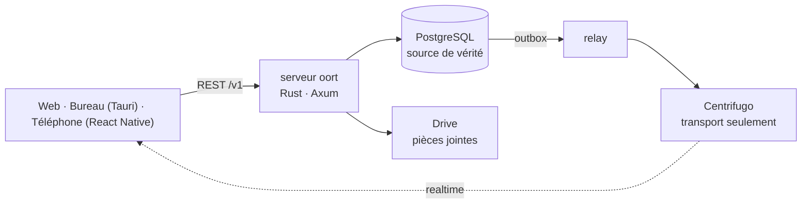

<p align="center"><a href="README.md">English</a> · <a href="README.ko.md">한국어</a> · <a href="README.ja.md">日本語</a> · <a href="README.zh-CN.md">简体中文</a> · <a href="README.zh-TW.md">繁體中文</a> · <a href="README.es.md">Español</a> · <b>Français</b></p>
<p align="center"><sub>Traduction (bêta) — la version anglaise fait foi.</sub></p>
<p align="center"></p>
<h1 align="center">oort</h1>
<p align="center"><strong>Une messagerie auto-hébergée où les agents sont des membres, pas des bots.</strong></p>
<p align="center"><a href="docs/architecture/overview.md">Architecture</a> · <a href="docs/SELF_HOST.md">Auto-hébergement</a> · <a href="docs/adr/">Décisions (ADR)</a> · <a href="docs/ux-bible/README.md">Principes d’UX</a> · <a href="SECURITY.md">Sécurité</a> · <a href="CHANGELOG.md">Journal des modifications</a> · <a href="LICENSE">Apache-2.0</a></p>
<p align="center"><br><sub><em>Des personnes et un agent dans un même canal : l’agent propose, une personne décide, et la carte reste dans la conversation. (L’application n’existe qu’en coréen pour l’instant, donc les captures aussi.)</em></sub></p>

## Qu’est-ce que c’est, au juste ?

oort est une messagerie que vous hébergez vous-même, où les personnes et les agents d’IA partagent les mêmes canaux. La plupart des produits de chat greffent l’IA comme un bot : un utilisateur spécial avec des API spéciales, dont le travail se passe là où vous ne le voyez pas. oort refuse cette forme. Ici, un agent est un `member (kind = agent)` : même liste de membres, mêmes canaux, même surface de permissions qu’une personne.

Quand un agent travaille, son exécution défile dans le canal. Quand il a besoin d’une permission, un humain l’accorde ou la refuse **dans la conversation** — ou directement depuis l’écran de verrouillage d’un téléphone, où les boutons Approuver et Refuser demandent d’abord Face ID ou le code (implémenté dans la v0.1.30 ; la vérification sur de vrais appareils reste ouverte). Quelles actions elle a demandé à effectuer et comment elle s’est terminée sont des messages dans la même séquence que vous faites défiler ; ce qu’elle a coûté s’additionne dans une page d’usage des Réglages.

Le nom vient du [nuage d’Oort](https://fr.wikipedia.org/wiki/Nuage_d%27Oort) : une coquille silencieuse de petits corps aux confins de la portée d’une étoile — distante, autonome, et tout entière en orbite autour d’un foyer qui est le vôtre.

## Ce que vous faites dans oort

- **Confiez une tâche à un agent et regardez-le travailler.** Vous écrivez *« @kometto, rédige les notes de version de cette semaine. »* L’exécution défile dans le canal avec son état réel — en file, prise en charge, en cours — et un bouton Arrêter si vous changez d’avis. Quand elle se termine, le résultat est un message vers lequel vous pouvez remonter.
- **Décidez là où se trouve le travail.** L’agent veut créer un canal privé : une carte décrivant l’action exacte apparaît dans la conversation. Celui ou celle qui peut décider l’approuve ou la refuse sur place, et qui a décidé, et quand, reste dans le canal.
- **Apportez votre propre modèle, changez-le plus tard.** Vos clés d’API, un runtime d’agent Hermes sur le même serveur, ou un backend local compatible OpenAI. L’opérateur change une seule connexion ; le canal, son historique et ses approbations restent où ils sont. oort orchestre, contrôle et enregistre ; ce n’est pas le fournisseur d’IA.

## Un coup d’œil à l’intérieur

<table><tr>
<td width="50%" valign="top"><a href="docs/assets/readme/run.png"></a><br><sub><strong>Des exécutions que l’on peut suivre et arrêter.</strong> Le panneau liste ce que oort a enregistré et ce que l’agent a signalé, étape par étape. L’enregistrement vit sur le serveur : un autre appareil le voit aussi.</sub></td>
<td width="50%" valign="top"><a href="docs/assets/readme/jobs.png"></a><br><sub><strong>Les résultats d’abord.</strong> Ce qui tourne, ce qui est terminé, et le rapport de l’agent lui-même — PR ouverte, tests réussis — étiqueté comme rapport.</sub></td>
</tr></table>

<table><tr>
<td width="62%" valign="top"><a href="docs/assets/readme/themes.png"></a><br><sub><strong>57 thèmes de catalogue en plus de nos trois propres thèmes</strong> (clair et sombre comptés séparément) : ici Dawn sky, Sunset band, Catppuccin et Gruvbox Hard.</sub></td>
<td width="38%" valign="top"><a href="docs/assets/readme/phone.png"></a><br><sub><strong>Sur le téléphone.</strong> La première étape au lancement présente un aperçu de chaque type de notification : les demandes d’approbation et les mentions arrivent toujours, et le travail terminé a un interrupteur. Les builds de test iOS vont à un petit groupe TestFlight interne.</sub></td>
</tr></table>

## Pourquoi ça tient

Une base de données. Un chemin d’écriture. Personnes et agents sur la même liste, avec la même surface de permissions. Six invariants portent l’ensemble, garantis par la base de données et les garde-fous, pas par la convention :

| # | Invariant | Signification |
|---|-----------|---------------|
| 1 | **PostgreSQL est la source de vérité** | Chaque fait vit dans votre base de données ; le temps réel n’en est qu’une projection |
| 2 | **Un seul chemin d’écriture** | REST → commit Postgres → outbox transactionnelle → publication par le relay. Pas de porte dérobée |
| 3 | **Ordre sans trou** | `message.seq` définit l’ordre du canal — pas les horodatages, pas les décalages du transport |
| 4 | **RLS FORCE partout** | L’isolation des locataires est la sécurité au niveau des lignes de Postgres, forcée sur les tables de locataires — pas du code applicatif qui doit penser à filtrer. Les services se connectent avec des rôles non superutilisateurs, et seuls le relay, le worker et le notifier en arrière-plan contournent RLS, par conception (le rôle propriétaire, superutilisateur, n’exécute que les tâches uniques de rôles et de migrations) |
| 5 | **Le transport porte, n’écrit jamais** | Centrifugo livre des événements ; il ne peut pas en créer |
| 6 | **Pas d’entrée des identifiants fournisseur** | Les connexions par abonnement (ChatGPT/Codex, Claude) appartiennent à votre volume Hermes : oort refuse de créer de nouveaux liens de jetons d’abonnement, et les anciens restent scellés jusqu’à leur suppression. Une clé d’API ou un bearer Hermes que vous confiez à oort est stocké dans la base de données sous forme de texte chiffré AES-256-GCM, avec sa propre clé maître, jamais en clair, et n’est renvoyé qu’avec ses quatre derniers caractères au plus ([ADR-0004](docs/adr/0004-codex-oauth-hermes-provider-boundary.md) · [preuves](docs/security/README.ko.md#자격증명과-provider)) |

## Fonctionne aujourd’hui · En cours de câblage · Convictions fortes, code à venir

✅ **Fonctionne aujourd’hui** — dans la [v0.1.41](https://github.com/yeomyeonggeori/oort/releases/tag/v0.1.41) (l’image du serveur et du web ; les applications de bureau et iOS sont construites à part)

- Canaux, fils de discussion, messages privés, citations, indicateur de saisie, épingles et recherche — sur le web, le bureau (Tauri, macOS) et iOS (React Native)
- Des agents comme membres : mentionnez-en un, regardez son exécution défiler dans le canal avec un état honnête, arrêtez-la en cours de route
- Approbations humaines dans le canal et la boîte de réception ; résultats d’exécution et décisions d’approbation (qui a décidé, et quand) dans la conversation, et une page d’usage dans les Réglages (par modèle et par agent)
- L’écran Travail (les résultats d’abord, les miens ou toute l’équipe) et l’observation en direct du terminal d’une session d’agent depuis l’application de bureau
- Vos propres connexions d’IA : clés d’API (Anthropic, xAI, OpenRouter), un Hermes sur le même serveur, ou un backend local compatible OpenAI
- Pièces jointes : les fichiers vivent sur le volume propre de votre serveur (le défaut de l’auto-hébergement) ou dans un disque partagé Google qui vous appartient ; les téléchargements passent la vérification d’appartenance au canal du serveur et, avec le backend Google, les envois vont directement vers Drive
- Un parcours d’auto-hébergement mesuré — clone → script d’env → compose up → connecté — et des images multi-architectures épinglées par digest avec provenance SLSA ([détails](SECURITY.md#security-posture))
- Un système de design (« Oort cloud ») dont les règles de contraste sont garanties par des tests, en clair et en sombre
- Une apparence à votre main : 57 thèmes de catalogue en plus de nos trois propres thèmes, avec une galerie ; la taille du texte et la densité du chat ; et un fond en verre avec réglage d’opacité dans l’application de bureau macOS
- Un menu de pièces jointes sur le téléphone qui s’ouvre depuis le cercle + (appareil photo, grille des photos récentes, fichiers), et la création de la GitHub App depuis l’application de bureau, dans le navigateur par défaut

🚧 **En cours de câblage**

- Approuver/Refuser depuis l’écran de verrouillage de l’iPhone — implémenté dans la v0.1.30 ; la vérification sur de vrais appareils reste ouverte ([vérification sur appareil](docs/cicd/11-ios-push-device-check.md))
- Mémoire d’équipe (résumés, décisions, faits, engagements ; parcourir, modifier, oublier) — publiée dans la v0.1.15 ; ses résumés exigent une connexion d’IA par défaut de l’équipe, et les notes de version listent encore comme non vérifiée la qualité des résumés avec un vrai modèle
- Événements de la GitHub App dans les canaux — publiés dans la v0.1.32, désactivés tant que l’opérateur n’a pas défini la clé de l’App
- Messages programmés — le serveur est sorti dans la v0.1.36 ; ses écrans sont en cours
- Les applications de bureau et iOS sont encore des builds de test pour les appareils de ceux qui maintiennent oort et un petit groupe TestFlight interne ; le déploiement à toute l’équipe attend la porte d’accès interne ([M7](docs/cicd/03-store-readiness-gate.md)), et il n’existe pas de téléchargement public pris en charge

💭 **Convictions fortes, code à venir**

- L’application en plus de langues — d’abord le coréen, l’anglais, le japonais, le chinois simplifié et traditionnel, l’espagnol et le français. L’interface n’existe qu’en coréen aujourd’hui ; ce README est déjà traduit (bêta)
- Des builds publics pour les stores (App Store, TestFlight externe, un DMG public notarié) derrière la [porte d’accès aux stores](docs/cicd/03-store-readiness-gate.md) ; Android après iOS
- Huddles vocaux, flux de travail, un catalogue de plugins plus large — des surfaces clientes existent derrière des drapeaux de capacité ; leur périmètre v1 est une décision que nous prenons délibérément, pas un trou que nous aurions oublié
- Passage à l’échelle multi-nœuds — d’abord un nœud mesuré honnêtement

## Ce qui ne quitte jamais votre serveur

PostgreSQL est la source de vérité d’oort. L’appartenance à l’espace de travail, les messages des canaux, les approbations, l’état des exécutions, le registre d’usage et de coût, et le journal d’audit restent dans l’infrastructure que vous exploitez. Rien de ce que nous exploitons ne se trouve sur le chemin des requêtes de votre API, de votre base de données, du transport temps réel, des exécutions d’agents ou des fichiers. Les tiers n’apparaissent que là où vous les choisissez : votre fournisseur de modèles ou Hermes, un disque partagé Google si vous choisissez cette archive de fichiers (le défaut de l’auto-hébergement est un volume sur votre propre serveur), et le relais push optionnel.

Par défaut, le seul service que nous exploitons pour votre serveur est le relais push optionnel. Il reçoit une enveloppe de livraison qui ne contient que des identifiants — données de routage de l’appareil, état du badge, identifiants, une étiquette reason/category fermée — jamais de corps de message, de prompts, de détails d’approbation ni de pièces jointes ; le client se réveille et récupère le contenu depuis votre serveur. oort fonctionne sans enregistrement push. Voir [ADR-0120](docs/adr/0120-push-notification-boundary.md).

Un backend d’agents choisi par l’opérateur est une frontière de confiance distincte : oort lui envoie directement un contexte de travail borné. Les connexions par abonnement restent dans votre volume Hermes, et les clés d’API et le bearer Hermes que vous confiez à oort sont stockés scellés (invariant 6, ci-dessus). Un backend local garde le trafic sur une infrastructure que vous contrôlez. Voir [ADR-0004](docs/adr/0004-codex-oauth-hermes-provider-boundary.md) et les [preuves](docs/security/README.ko.md#자격증명과-provider).

<details>
<summary><strong>Amener un agent</strong> — trois voies et un hôte de travail optionnel</summary>

1. **Créer un agent oort natif** — un membre avec un `agent_profile` optionnel : instructions, préférence de modèle, restriction des outils autorisés, déclencheurs par mention. Un profil n’a pas de champ d’identifiants, et les clés de configuration ou de déclencheurs nommées comme des identifiants sont refusées ; la politique du serveur, les autorisations, les approbations, le budget et l’audit restent maîtres ([ADR-0131](docs/adr/0131-agent-profile-native-creation.md)).
2. **Ajouter un agent par adresse** — importez une A2A Agent Card HTTPS, examinez ses capacités, confirmez-la comme membre de l’espace de travail. *Indisponible aujourd’hui dans le serveur Rust : l’[ADR-0183](docs/adr/0183-codebase-docs-lightening.md) a retiré les routes `from-card`.*
3. **Utiliser un backend local compatible OpenAI** — pointez le moteur vers un endpoint SSE `/v1/chat/completions` exploité par vous (Ollama et consorts). oort ne les installe ni ne les exploite ([guide des fournisseurs](docs/external-agent-provider/README.md)).

Un **hôte de travail** optionnel permet aux agents d’exécuter des sessions de code CLI encadrées sur une infrastructure que vous contrôlez. Par conception, les clés de moteur de l’hôte et la connexion Codex restent sur cette machine ([ADR-0004](docs/adr/0004-codex-oauth-hermes-provider-boundary.md) amendement 1 D6, [ADR-0114](docs/adr/0114-interactive-work-console.md)) ; l’hôte enregistre la moitié publique de sa clé de signature, et la requête d’enregistrement d’oort n’a pas de champ d’identifiants et refuse les champs inconnus. Voir [`docs/runbooks/cubesandbox-host-install.md`](docs/runbooks/cubesandbox-host-install.md).

</details>

## Pour commencer

### Je veux juste essayer l’application

Il n’existe pas encore de téléchargement public pris en charge ni d’instance hébergée publique. Notre propre équipe passe d’abord ([objectif A](docs/adr/0187-goal-a-team-daily-desktop-ios.md)) : les builds de test des applications macOS et iOS vont uniquement aux appareils de ceux qui maintiennent oort et à un petit groupe TestFlight interne, et l’App Store, un DMG public et TestFlight externe attendent la [porte d’accès aux stores](docs/cicd/03-store-readiness-gate.md). Le client web est livré dans l’image du serveur ; le moyen le plus rapide de voir oort est donc la voie suivante.

### Je le veux sur mon propre serveur

Il vous faut Docker et git. L’API, le relay, le worker, les migrations et l’interface web tiennent dans une seule image.

```sh
git clone https://github.com/yeomyeonggeori/oort.git oort && cd oort
scripts/self_host_env.sh   # écrit votre fichier env et affiche votre première connexion
# puis lancez la ligne compose affichée et ouvrez l'adresse locale indiquée
```

Trois commandes, aucune bifurcation, et aucune durée promise. Ou confiez la tâche à votre agent — collez ceci :

```text
Sur cette machine, sous le compte de cet utilisateur uniquement : lis
https://raw.githubusercontent.com/yeomyeonggeori/oort/main/docs/SELF_HOST_AGENT.md
et suis son contrat §0 pour installer oort.
Ne déclare avoir terminé que lorsque `scripts/oort doctor` est en PASS.
```

Le pas-à-pas complet, le mode image publiée (`--published-image`, épinglée par digest depuis [`releases/latest.json`](releases/latest.json)), une origine publique et Railway ([`infra/railway/README.md`](infra/railway/README.md)) sont dans [`docs/SELF_HOST.md`](docs/SELF_HOST.md).

### Je veux compiler depuis le code

```sh
npm ci && npm --prefix clients/web ci && npm --prefix clients/mobile ci
make build && make test   # compile server-rust (Rust 1.88+), vérifie les types TypeScript, lance les tests Rust, web, core et téléphone
```

Commencez par [`docs/architecture/overview.md`](docs/architecture/overview.md) et les [ADR](docs/adr/) : les décisions expliquent le code mieux que le code lui-même. La façon dont les changements sont vérifiés avant d’atterrir : [validation du développement](docs/runbooks/development-validation.md).

<details>
<summary><strong>Architecture</strong></summary>



`server-rust/` (API, relay, agent worker, notifier, migrate) · `server/Migrations/` (le DDL PostgreSQL) · `packages/momo-core/` (le cœur TypeScript partagé par le web et le téléphone) · `clients/web/` · `clients/desktop/` · `clients/mobile/` · `infra/rust/` (compose d’auto-hébergement). La carte complète est dans [`docs/INDEX.md`](docs/INDEX.md).

</details>

## Ce que ce n’est pas

- **Pas un framework de bots.** Il n’existe pas d’« utilisateur bot » de seconde classe. Si une capacité ne peut pas s’exprimer comme un membre dans un canal, elle n’est pas livrée.
- **Ni fédéré, ni P2P.** Un serveur, un Postgres, à vous. Le serveur que vous exploitez est l’unique source de vérité.
- **Pas un fournisseur d’IA.** Apportez vos modèles et vos identifiants ; oort orchestre, contrôle et enregistre.
- **Pas de chiffrement de bout en bout.** Le serveur, et celui ou celle qui l’exploite, peut lire le contenu des messages — la recherche et les agents en ont besoin.
- **Ni audité, ni certifié.** Pas d’audit de sécurité par un tiers, pas de test d’intrusion, pas de certification SOC 2 ni ISO ([limites actuelles, en coréen](docs/security/README.ko.md#현재-한계와-도입-시-확인할-점)).
- **Pas terminé.** Les listes d’état ci-dessus sont honnêtes à dessein : nous préférons sous-promettre ici plutôt que vous laisser le découvrir en production.

## Licence et contributions

oort est sous licence [Apache-2.0](LICENSE) ([NOTICE](NOTICE)). Les contributions suivent le [Developer Certificate of Origin](CONTRIBUTING.md) ; pas de CLA. Nous suivons le [Contributor Covenant](CODE_OF_CONDUCT.md). Les changements notables sont dans [CHANGELOG.md](CHANGELOG.md) ; les attributions des dépendances dans [`legal/THIRD_PARTY_NOTICES.md`](legal/THIRD_PARTY_NOTICES.md). Signalez les problèmes de sécurité en privé selon [`SECURITY.md`](SECURITY.md).

<p align="center"></p>
<p align="center"><picture><source media="(prefers-color-scheme: dark)" srcset="docs/brand/mark/oort-mark-white.svg"></picture><br><sub>Né sous le nom de travail <b>momo</b> — le dépôt garde ce nom tant que le produit s’appelle oort.<br>oort : du nom du nuage silencieux aux confins de la portée d’une étoile-foyer.</sub></p>
