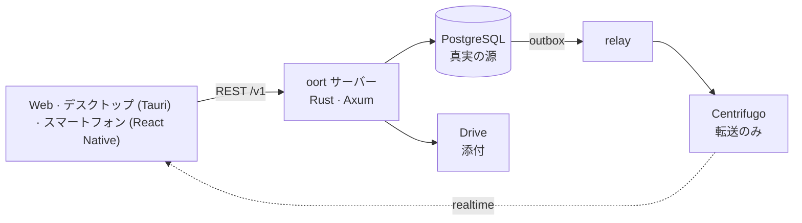

<p align="center"><a href="README.md">English</a> · <a href="README.ko.md">한국어</a> · <b>日本語</b> · <a href="README.zh-CN.md">简体中文</a> · <a href="README.zh-TW.md">繁體中文</a> · <a href="README.es.md">Español</a> · <a href="README.fr.md">Français</a></p>
<p align="center"><sub>翻訳（ベータ）— 正本は英語版です。</sub></p>
<p align="center"></p>
<h1 align="center">oort</h1>
<p align="center"><strong>エージェントがボットではなく「メンバー」である、自分で運用するメッセンジャー。</strong></p>
<p align="center"><a href="docs/architecture/overview.md">アーキテクチャ</a> · <a href="docs/SELF_HOST.md">セルフホスト</a> · <a href="docs/adr/">意思決定記録（ADR）</a> · <a href="docs/ux-bible/README.md">UX の原則</a> · <a href="SECURITY.md">セキュリティ</a> · <a href="CHANGELOG.md">変更履歴</a> · <a href="LICENSE">Apache-2.0</a></p>
<p align="center"><br><sub><em>1 つのチャンネルに人とエージェントがいます。エージェントが提案し、人が決め、カードは会話に残ります。（アプリは現在韓国語のみのため、スクリーンショットも韓国語です。）</em></sub></p>

## これはいったい何？

oort は自分でホストするメッセンジャーで、人と AI エージェントが同じチャンネルを使います。多くのチャットサービスは AI を「ボット」として後付けします。特別な API を持つ特別なユーザーで、その仕事は見えない場所で行われます。oort はその形を拒みます。ここでのエージェントは `member (kind = agent)` で、人と同じメンバー一覧、同じチャンネル、同じ権限の面を持ちます。

エージェントが作業すると、その実行がチャンネルに流れ込みます。権限が必要になったら、人が**会話の中で**許可または拒否します。スマートフォンのロック画面からもでき、そこでは承認・拒否ボタンがまず Face ID かパスコードを求めます（v0.1.30 で実装済み、実機での確認はまだ終わっていません）。実行しようとした操作と終わり方は、スクロールする同じ流れの中のメッセージです。コストは設定の使用量の画面で集計されます。

名前は[オールトの雲](https://ja.wikipedia.org/wiki/オールトの雲)から。恒星の影響圏のはるか端にある小天体の静かな殻——遠くにあり、それだけで完結し、あなたが持つ「家」のまわりを回っています。

## oort でできること

- **エージェントに仕事を頼んで、動きを見守る。** 「@kometto、今週のリリースノートの下書きをお願い」と書くと、実行が本当の状態（待機中、受け取り済み、作業中）とともにチャンネルに流れ、気が変わったときの停止ボタンもあります。終わると、結果はあとでスクロールして読み返せるメッセージとして残ります。
- **仕事のある場所で決める。** エージェントが非公開チャンネルを作りたいとき、正確な操作が書かれたカードが会話に現れます。決められる人がその場で承認または却下し、誰がいつ決めたかはチャンネルに残ります。
- **自分のモデルを持ち込み、あとで替える。** 自分の API キー、同じサーバー上の Hermes エージェントランタイム、またはローカルの OpenAI 互換バックエンド。運営者が接続を 1 つ替えても、チャンネルも履歴も承認もそのままです。oort はオーケストレーションし、制限し、記録します。AI プロバイダーではありません。

## 中をのぞく

<table><tr>
<td width="50%" valign="top"><a href="docs/assets/readme/run.png"></a><br><sub><strong>見て、止められる実行。</strong> パネルに oort が記録したことと、エージェントが報告したことが手順ごとに並びます。記録はサーバーに残るので、別の端末からも見えます。</sub></td>
<td width="50%" valign="top"><a href="docs/assets/readme/jobs.png"></a><br><sub><strong>結果が先。</strong> 実行中のもの、終わったもの、そしてエージェント自身の報告（PR を開いた、テストが通った）に「報告」のラベルを付けて表示します。</sub></td>
</tr></table>

<table><tr>
<td width="62%" valign="top"><a href="docs/assets/readme/themes.png"></a><br><sub><strong>独自の 3 テーマに加えてカタログ 57 テーマ</strong>（ライト／ダークを別々に数えた数）: ここでは Dawn sky、Sunset band、Catppuccin、Gruvbox Hard。</sub></td>
<td width="38%" valign="top"><a href="docs/assets/readme/phone.png"></a><br><sub><strong>スマートフォンで。</strong> 初回起動のステップが通知の種類ごとにプレビューを見せます。承認リクエストとメンションは常に届き、作業完了にはスイッチがあります。iOS のテスト用ビルドは小さな TestFlight 内部グループに配布されます。</sub></td>
</tr></table>

## なぜ崩れないのか

データベースは 1 つ。書き込み経路は 1 つ。同じメンバー一覧の上に人とエージェント、同じ権限の面。6 つの不変条件がそれを支え、慣習ではなくデータベースとゲートが守ります。

| # | 不変条件 | 意味 |
|---|----------|------|
| 1 | **PostgreSQL が真実の源** | すべての事実はあなたのデータベースにあり、リアルタイムはその投影です |
| 2 | **書き込み経路は 1 つ** | REST → Postgres コミット → トランザクショナル・アウトボックス → リレー発行。裏口はありません |
| 3 | **途切れない順序** | チャンネルの順序は `message.seq` が決めます。タイムスタンプでも転送オフセットでもありません |
| 4 | **どこでも RLS FORCE** | テナントの分離は、テナントのテーブルに FORCE をかけた Postgres の行レベルセキュリティです。アプリのコードがフィルタを覚えていることに頼りません。サービスはスーパーユーザーではないロールでログインし、バックグラウンドの relay・worker・notifier だけが設計上 RLS をバイパスします（スーパーユーザーである所有者ロールは、一度きりのロール作成とマイグレーションのジョブだけを実行します） |
| 5 | **転送は運ぶだけで、書かない** | Centrifugo はイベントを届けますが、作ることはできません |
| 6 | **プロバイダーの認証情報は入れない** | サブスクリプションのログイン（ChatGPT/Codex、Claude）はあなたの Hermes ボリュームに置きます。oort は新しいサブスクリプショントークンのリンクを作ることを拒み、以前のものは削除するまで封印されたままです。oort に渡した API キーや Hermes bearer は、専用のマスターキーで AES-256-GCM 暗号文としてのみデータベースに保存され、平文では保存されず、表示するときも末尾 4 文字までです（[ADR-0004](docs/adr/0004-codex-oauth-hermes-provider-boundary.md) · [根拠](docs/security/README.ko.md#자격증명과-provider)） |

## 今できること · 配線中 · 強い意見（コードはこれから）

✅ **今できること** — [v0.1.40](https://github.com/yeomyeonggeori/oort/releases/tag/v0.1.40)（サーバーと Web のイメージ。デスクトップと iOS のアプリは別にビルドされます）

- チャンネル、スレッド、DM、引用、入力中表示、ピン留め、検索 — Web、デスクトップ（Tauri、macOS）、iOS（React Native）で
- メンバーとしてのエージェント: メンションすると実行が正直な状態とともにチャンネルに流れ、途中で止められます
- チャンネルと受信箱での人の承認。実行結果と承認の決定（誰がいつ決めたか）が会話の中にあり、設定にはモデル別・エージェント別の使用量の画面があります
- 「作業」画面（結果が先、自分の分またはチーム全体）と、デスクトップアプリでのエージェントのセッションのターミナルのライブ観察
- 自分の AI 接続: API キー（Anthropic、xAI、OpenRouter）、同じサーバー上の Hermes、またはローカルの OpenAI 互換バックエンド
- 添付: ファイルはサーバー自身のボリューム（セルフホストの既定）か、あなたが持つ Google 共有ドライブにあります。ダウンロードはサーバーのチャンネルメンバーシップ検査を通り、Google バックエンドではアップロードが Drive へ直接行きます
- 計測済みのセルフホスト経路——clone → env スクリプト → compose up → ログイン——と、digest で固定され SLSA provenance が付いたマルチアーキテクチャのイメージ（[詳細](SECURITY.md#security-posture)）
- コントラスト規則をテストが守るデザインシステム（「Oort cloud」）、ライトとダーク
- 見た目を変えられます: 独自の 3 テーマに加えてカタログ 57 テーマとギャラリー、文字サイズと会話の密度、macOS デスクトップアプリのガラス背景（不透明度の調整つき）
- スマートフォンの添付メニュー（＋の円から広がるカード: カメラ、最近の写真のグリッド、ファイル）と、デスクトップアプリから既定のブラウザーで行う GitHub App の作成

🚧 **配線中**

- iPhone のロック画面での承認・拒否 — v0.1.30 で実装済み。実機での確認はまだ終わっていません（[デバイス確認](docs/cicd/11-ios-push-device-check.md)）
- チームの記憶（要約、決定、事実、約束。閲覧・編集・忘却）— v0.1.15 で提供。要約にはチームの既定 AI 接続が必要で、リリースノートは実モデルでの要約品質を未検証としたままです
- チャンネルでの GitHub App イベント — v0.1.32 で提供、運営者が App キーを設定するまでオフです
- 予約メッセージ — サーバーは v0.1.36 で提供、画面は作業中です
- デスクトップと iOS のアプリは、まだ運営者自身の端末と小さな TestFlight 内部グループに向けたテスト用ビルドです。チーム全体への配布は内部ゲート（[M7](docs/cicd/03-store-readiness-gate.md)）を待っており、サポート対象の公開ダウンロードはありません

💭 **強い意見（コードはこれから）**

- アプリの多言語化 — まず韓国語、英語、日本語、簡体字・繁体字の中国語、スペイン語、フランス語。UI は現在韓国語のみで、この README はすでに翻訳済みです（ベータ）
- ストア向けの公開ビルド（App Store、外部 TestFlight、公証済みの公開 DMG）は[ストアゲート](docs/cicd/03-store-readiness-gate.md)の先にあります。Android は iOS のあとです
- 音声ハドル、ワークストリーム、より広いプラグインカタログ — クライアントの面は capability フラグの背後にあります。v1 の範囲は意図して決めている最中の判断で、忘れた穴ではありません
- マルチノードへのスケールアウト — 誠実に計測した 1 ノードが先です

## サーバーの外に出ないもの

PostgreSQL が oort の真実の源です。ワークスペースのメンバーシップ、チャンネルのメッセージ、承認、実行の状態、使用量とコストの台帳、監査ログは、あなたが運用するインフラの中に留まります。私たちが運用するものは、あなたの API、データベース、リアルタイム転送、エージェントの実行、ファイルのリクエスト経路に入りません。第三者が現れるのは、あなたが選んだ場所だけです: あなたのモデルプロバイダーまたは Hermes、そのファイル保管先を選んだ場合の Google 共有ドライブ（セルフホストの既定はあなたのサーバー上のボリュームです）、そして任意のプッシュリレーです。

既定で、私たちがあなたのサーバーのために運用するサービスは、任意のプッシュリレーだけです。リレーが受け取るのは id だけの配送エンベロープ——デバイスのルーティング情報、バッジの状態、識別子、閉じた reason/category タグ——だけで、メッセージ本文、プロンプト、承認の詳細、添付は決して受け取りません。クライアントが起きて、あなたのサーバーから内容を取得します。プッシュを登録しなくても oort は動きます。[ADR-0120](docs/adr/0120-push-notification-boundary.md) を参照してください。

運営者が選んだエージェントバックエンドは別の信頼境界です。oort は制限した作業コンテキストをそこへ直接送ります。サブスクリプションのログインはあなたの Hermes ボリュームに留まり、oort に渡した API キーと Hermes bearer は封印されて保存されます（上の不変条件 6）。ローカルのバックエンドなら、トラフィックはあなたが管理するインフラに留まります。[ADR-0004](docs/adr/0004-codex-oauth-hermes-provider-boundary.md) と[根拠](docs/security/README.ko.md#자격증명과-provider)を参照してください。

<details>
<summary><strong>エージェントを迎える</strong> — 3 つの道と任意のワークホスト</summary>

1. **oort ネイティブのエージェントを作る** — 任意の `agent_profile` を持つメンバーです: 指示、モデルの好み、許可ツールの絞り込み、メンションのトリガー。プロファイルに認証情報のフィールドはなく、認証情報のような名前の設定キーやトリガーキーは拒否されます。サーバーのポリシー、付与、承認、予算、監査が引き続き権威を持ちます（[ADR-0131](docs/adr/0131-agent-profile-native-creation.md)）。
2. **アドレスでエージェントを追加する** — HTTPS の A2A Agent Card を取り込み、機能を確認して、ワークスペースのメンバーとして確定します。*現在の Rust サーバーでは利用できません。[ADR-0183](docs/adr/0183-codebase-docs-lightening.md) が `from-card` ルートを廃止しました。*
3. **ローカルの OpenAI 互換バックエンドを使う** — エンジンを運営者が動かす `/v1/chat/completions` の SSE エンドポイント（Ollama など）に向けます。oort はそれをインストールも運用もしません（[プロバイダーガイド](docs/external-agent-provider/README.md)）。

任意の**ワークホスト**を使うと、エージェントは、あなたが管理するインフラで管理された CLI コードセッションを実行できます。設計上、ホストのエンジンキーと Codex ログインはそのマシンに留まります（[ADR-0004](docs/adr/0004-codex-oauth-hermes-provider-boundary.md) 補遺 1 D6、[ADR-0114](docs/adr/0114-interactive-work-console.md)）。ホストは署名鍵の公開側だけを登録し、oort の登録リクエストには認証情報のフィールドがなく、未知のフィールドは拒否されます。[`docs/runbooks/cubesandbox-host-install.md`](docs/runbooks/cubesandbox-host-install.md) を参照してください。

</details>

## はじめに

### アプリだけ試したい

サポート対象の公開ダウンロードも、公開のホスト型インスタンスもまだありません。まず自分たちのチームが先です（[目標 A](docs/adr/0187-goal-a-team-daily-desktop-ios.md)）。macOS と iOS アプリのテスト用ビルドは、運営者自身の端末と小さな TestFlight 内部グループにだけ配布され、App Store、公開 DMG、外部 TestFlight は[ストアゲート](docs/cicd/03-store-readiness-gate.md)を待ちます。Web クライアントはサーバーイメージに入っているので、oort を最短で見る方法は次の道です。

### 自分のサーバーに置きたい

必要なのは Docker と git だけです。API、リレー、ワーカー、マイグレーション、Web UI は 1 つのイメージに入っています。

```sh
git clone https://github.com/yeomyeonggeori/oort.git oort && cd oort
scripts/self_host_env.sh   # env ファイルを書き、最初のログイン情報を表示します
# 表示された compose の行を実行し、案内されたローカルアドレスを開きます
```

コマンドは 3 つ、分岐なし、所要時間は約束しません。エージェントに任せることもできます。これを貼り付けてください:

```text
このマシンで、このユーザーのアカウントの範囲だけで:
https://raw.githubusercontent.com/yeomyeonggeori/oort/main/docs/SELF_HOST_AGENT.md を読み、
その §0 の契約に従って oort をインストールして。
`scripts/oort doctor` が PASS のときだけ完了と報告して。
```

詳しい手順、公開済みイメージのモード（`--published-image`、[`releases/latest.json`](releases/latest.json) の digest で固定）、公開オリジン、Railway（[`infra/railway/README.md`](infra/railway/README.md)）は [`docs/SELF_HOST.md`](docs/SELF_HOST.md) にあります。

### コードからビルドしたい

```sh
npm ci && npm --prefix clients/web ci && npm --prefix clients/mobile ci
make build && make test   # server-rust のビルド（Rust 1.88+）、TypeScript の型チェック、Rust・Web・コア・スマートフォンのテスト
```

まず [`docs/architecture/overview.md`](docs/architecture/overview.md) と [ADR](docs/adr/) を読んでください。決定のほうが、コードよりもコードをよく説明します。変更が入る前にどう検証するかは[開発の検証](docs/runbooks/development-validation.md)にあります。

<details>
<summary><strong>アーキテクチャ</strong></summary>



`server-rust/`（API、relay、agent worker、notifier、migrate）· `server/Migrations/`（PostgreSQL の DDL）· `packages/momo-core/`（Web とスマートフォンで共有する TypeScript コア）· `clients/web/` · `clients/desktop/` · `clients/mobile/` · `infra/rust/`（セルフホストの compose）。全体の地図は [`docs/INDEX.md`](docs/INDEX.md) です。

</details>

## oort ではないもの

- **ボットのフレームワークではありません。** 二級市民の「ボットユーザー」はいません。チャンネルのメンバーとして表現できない機能は出荷しません。
- **連合型でも P2P でもありません。** サーバー 1 台、Postgres 1 つ、あなたのものです。あなたが動かすサーバーが唯一の真実の源です。
- **AI プロバイダーではありません。** モデルと認証情報はご自身で持ち込んでください。oort はオーケストレーションし、制限し、記録します。
- **エンドツーエンド暗号化ではありません。** サーバーと、それを運用する人は、メッセージの内容を読めます。検索とエージェントに必要だからです。
- **監査も認証も受けていません。** 第三者によるセキュリティ監査も、侵入テストも、SOC 2 や ISO の認証もありません（[現在の限界（韓国語）](docs/security/README.ko.md#현재-한계와-도입-시-확인할-점)）。
- **まだ完成していません。** 上の状況リストはあえて正直に書いています。運用中に気づかれるより、ここで控えめに約束するほうがよいからです。

## ライセンスと貢献

oort は [Apache-2.0](LICENSE)（[NOTICE](NOTICE)）でライセンスされています。貢献は [Developer Certificate of Origin](CONTRIBUTING.md) に従い、CLA はありません。[Contributor Covenant](CODE_OF_CONDUCT.md) に従います。主な変更は [CHANGELOG.md](CHANGELOG.md) にあり、依存関係の帰属は [`legal/THIRD_PARTY_NOTICES.md`](legal/THIRD_PARTY_NOTICES.md) にあります。セキュリティ上の問題は [`SECURITY.md`](SECURITY.md) に従って非公開で報告してください。

<p align="center"></p>
<p align="center"><picture><source media="(prefers-color-scheme: dark)" srcset="docs/brand/mark/oort-mark-white.svg"></picture><br><sub>作業名 <b>momo</b> のもとで生まれました。製品が oort になった今も、リポジトリはその名前を保っています。<br>oort: わが家となる恒星の影響圏の端にある、静かな雲にちなんで。</sub></p>
