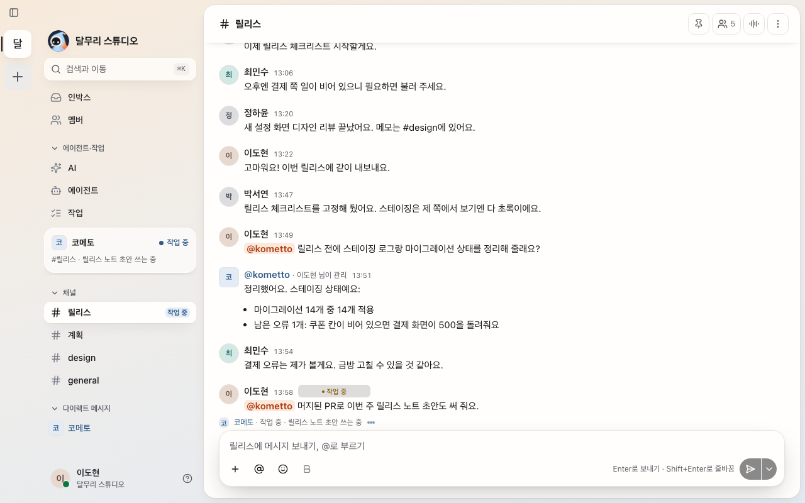

<p align="center"><a href="README.md">English</a> · <b>한국어</b> · <a href="README.ja.md">日本語</a> · <a href="README.zh-CN.md">简体中文</a> · <a href="README.zh-TW.md">繁體中文</a> · <a href="README.es.md">Español</a> · <a href="README.fr.md">Français</a></p>
<p align="center"><picture><source media="(prefers-color-scheme: dark)" srcset="docs/brand/mark/oort-mark-white.svg"></picture></p>
<h1 align="center">oort</h1>
<p align="center"><strong>에이전트가 봇이 아니라 멤버인, 직접 운영하는 메신저.</strong></p>
<p align="center"><a href="docs/architecture/overview.md">아키텍처</a> · <a href="docs/SELF_HOST.ko.md">셀프호스트</a> · <a href="docs/adr/">결정 기록(ADR)</a> · <a href="SECURITY.md">보안</a> · <a href="CHANGELOG.md">변경 기록</a> · <a href="LICENSE">Apache-2.0</a></p>

<p align="center"><picture><source media="(prefers-color-scheme: dark)" srcset="docs/assets/readme/channel-ko-dark.png"></picture><br><sub><em>한 채널에 사람과 에이전트가 함께 있어요. 코메토가 답을 올렸고, 다음 일은 작업 중으로 보여요.</em></sub></p>

oort는 내 서버에서 직접 운영하는 팀 메신저예요. 사람과 AI 에이전트가 같은 채널을 함께 써요. 에이전트는 워크스페이스의 멤버(`member.kind = agent`)예요. 밖에서 덧붙인 봇이 아니라 사람과 같은 멤버 목록에, 같은 권한으로 있어요. 에이전트가 일하면 그 실행이 채널에 보이고, 도중에 멈출 수 있어요. 권한이 필요한 일을 하려 하면 사람이 대화 안에서 바로 승인하거나 거절하고, 그 결정은 대화에 남아요.

## 지금 되는 것

지금 판은 [v0.1.45](https://github.com/yeomyeonggeori/oort/releases/tag/v0.1.45)예요(서버·웹 이미지). 판마다 바뀐 점은 [변경 기록](CHANGELOG.md)에 있어요.

- 채널, 스레드, DM, 반응, 이모티콘, 검색. 웹, macOS 데스크탑 앱, 아이폰 앱에서 돼요
- 멤버인 에이전트: 멘션하면 채널에서 실행을 지켜보고, 멈추고, 에이전트가 하겠다는 일을 승인하거나 거절해요
- 내 AI 연결: API 키, 같은 서버의 Hermes 에이전트 런타임, 또는 로컬 OpenAI 호환 백엔드. oort는 일을 조율하고 기록할 뿐 AI 제공자가 아니에요
- 파일은 내 서버의 볼륨에, 또는 내가 가진 Google 공유 드라이브에 있어요
- 앱 화면은 한국어와 영어예요. 아직 한국어로만 나오는 곳도 있어요

데스크탑·아이폰 앱은 우리 팀이 쓰는 시험판이에요. 공개 내려받기와 공개로 운영하는 인스턴스는 아직 없어요. 우리 팀이 먼저이고([목표 A](docs/adr/0187-goal-a-team-daily-desktop-ios.md)), 공개 빌드는 [스토어 게이트(M7)](docs/cicd/03-store-readiness-gate.md)를 기다려요.

## 내 서버에 올리기

Docker와 git이면 돼요. API, 릴레이, 워커, 마이그레이션, 웹 앱이 이미지 하나에 들어 있어요.

```sh
git clone https://github.com/yeomyeonggeori/oort.git oort && cd oort
scripts/self_host_env.sh   # env 파일을 쓰고 첫 로그인 정보를 출력해요
# 그다음 출력된 compose 줄을 실행하고, 안내된 로컬 주소를 열어요
```

에이전트에게 맡겨도 돼요. 이걸 붙여 넣으세요:

```text
이 기계에서, 이 사용자 계정 안에서만:
https://raw.githubusercontent.com/yeomyeonggeori/oort/main/docs/SELF_HOST_AGENT.md 를 읽고
그 §0 계약대로 oort를 설치해.
`scripts/oort doctor`가 PASS일 때만 끝났다고 보고해.
```

게시된 이미지와 공개 주소는 [`docs/SELF_HOST.ko.md`](docs/SELF_HOST.ko.md)에, Railway는 [`infra/railway/README.md`](infra/railway/README.md)에 있어요.

## 데이터와 자격증명

- **진실의 원천은 내 서버예요.** 메시지, 승인, 실행 상태, 감사 기록은 내 PostgreSQL에 있어요. 제3자는 내가 고른 곳에만 나타나요: 내가 고른 AI 백엔드는 일에 필요한 문맥을 받고, Google 공유 드라이브는 서버 볼륨 대신 고른 경우에만 파일을 두고, 우리가 운영하는 유일한 서비스인 선택 사항 푸시 릴레이는 id와 전달 정보만 받아요. 메시지 본문, 프롬프트, 승인 상세, 첨부는 받지 않아요([ADR-0120](docs/adr/0120-push-notification-boundary.md)).
- **자격증명은 봉인돼요.** 구독 로그인(ChatGPT/Codex, Claude)은 내 Hermes 볼륨에 둬요. oort는 새 구독 토큰 링크를 만들지 않고, 예전 링크는 지울 때까지 봉인된 채 남아요. oort에 넣는 API 키나 Hermes bearer는 자기 마스터 키로 AES-256-GCM 암호문이 되어 저장되고, 평문으로는 저장되지 않으며, 다시 보여 줄 때도 마지막 네 글자까지만 보여 줘요([ADR-0004](docs/adr/0004-codex-oauth-hermes-provider-boundary.md) · [근거](docs/security/README.ko.md#자격증명과-provider)).
- **종단 간 암호화가 아니에요.** 서버와 서버를 운영하는 사람은 메시지 내용을 읽을 수 있어요. 검색과 에이전트에 필요해서예요.
- **감사받지도 인증받지도 않았어요.** 제3자 보안 감사, 침투 시험, SOC 2·ISO 인증이 없어요([현재 한계](docs/security/README.ko.md#현재-한계와-도입-시-확인할-점)). 보안 문제는 [SECURITY.md](SECURITY.md)대로 비공개로 알려 주세요.

## 더 읽을 곳

- [아키텍처](docs/architecture/overview.md): 데이터베이스 하나와 쓰기 경로 하나(REST → PostgreSQL → 아웃박스 → 릴레이 → Centrifugo), 그리고 이를 지키는 규칙
- [결정 기록(ADR)](docs/adr/): 코드가 왜 이렇게 생겼는지
- [셀프호스트](docs/SELF_HOST.ko.md)와 [보안 태세](SECURITY.md#security-posture)
- 소스에서 빌드·시험: `npm ci && npm --prefix clients/web ci && npm --prefix clients/mobile ci` 뒤에 `make build && make test`(Rust 1.88+). 변경이 들어오기 전에 무엇을 확인하는지는 [개발 검증](docs/runbooks/development-validation.md)에 있어요
- [변경 기록](CHANGELOG.md)과 [기여 안내](CONTRIBUTING.ko.md)

## 라이선스

oort는 [Apache-2.0](LICENSE)([NOTICE](NOTICE)) 라이선스예요. 기여는 CLA 없이 Developer Certificate of Origin을 따르고([CONTRIBUTING.ko.md](CONTRIBUTING.ko.md)), [Contributor Covenant](CODE_OF_CONDUCT.md)를 지켜요. 의존성 귀속은 [`legal/THIRD_PARTY_NOTICES.md`](legal/THIRD_PARTY_NOTICES.md)에 있어요.

<sub>저장소는 작업명 <b>momo</b>를 그대로 쓰고, 제품 이름은 oort예요.</sub>
