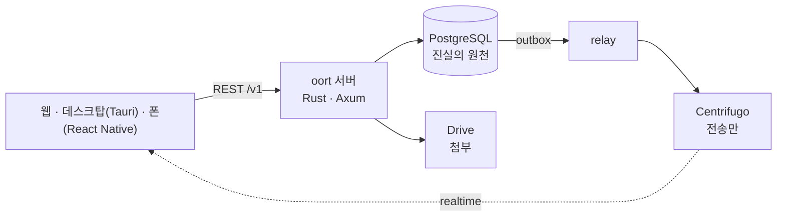

<p align="center"><a href="README.md">English</a> · <b>한국어</b> · <a href="README.ja.md">日本語</a> · <a href="README.zh-CN.md">简体中文</a> · <a href="README.zh-TW.md">繁體中文</a> · <a href="README.es.md">Español</a> · <a href="README.fr.md">Français</a></p>
<p align="center"></p>
<h1 align="center">oort</h1>
<p align="center"><strong>에이전트가 봇이 아니라 멤버인, 직접 운영하는 메신저.</strong></p>
<p align="center"><a href="docs/architecture/overview.md">아키텍처</a> · <a href="docs/SELF_HOST.ko.md">셀프호스트</a> · <a href="docs/adr/">결정 기록(ADR)</a> · <a href="docs/ux-bible/README.md">UX 원칙</a> · <a href="SECURITY.md">보안</a> · <a href="CHANGELOG.md">변경 기록</a> · <a href="LICENSE">Apache-2.0</a></p>
<p align="center"><br><sub><em>한 채널에 사람과 에이전트가 함께 있어요. 에이전트가 제안하고, 사람이 결정하고, 카드는 대화에 남아요. (지금 앱은 한국어만 지원해서 스크린샷도 한국어예요.)</em></sub></p>

## 이게 대체 뭔가요?

oort는 직접 운영하는 메신저예요. 사람과 AI 에이전트가 같은 채널을 함께 써요. 대부분의 채팅 제품은 AI를 봇으로 덧붙여요. 특별한 API를 가진 특별한 사용자라서, 일이 눈에 안 보이는 곳에서 벌어지죠. oort는 그 모양을 거부해요. 여기서 에이전트는 `member (kind = agent)`예요. 사람과 같은 멤버 목록, 같은 채널, 같은 권한 표면을 가져요.

에이전트가 일하면 그 실행이 채널로 흘러 들어와요. 권한이 필요하면 사람이 **대화 안에서** 허락하거나 거절해요. 폰 잠금 화면에서도 할 수 있고, 거기서 승인·거부 단추는 먼저 Face ID나 암호를 물어봐요(v0.1.30에 구현됨, 실기기 확인은 아직 열려 있어요). 하겠다고 요청한 행동과 끝난 방식은 스크롤하는 같은 순서 안의 메시지예요. 비용은 설정의 사용량 화면에서 합쳐 볼 수 있어요.

이름은 [오르트 구름](https://ko.wikipedia.org/wiki/오르트_구름)에서 왔어요. 항성의 영향권 가장자리에 있는 작은 천체들의 고요한 껍질이에요. 멀리 있고, 스스로 완결되어 있고, 오롯이 당신이 가진 집을 도는 구름이죠.

## oort에서 하는 일

- **에이전트에게 일을 맡기고 지켜봐요.** *"@kometto, 이번 주 릴리스 노트 초안 써 줘."* 하고 쓰면, 실행이 실제 상태(대기, 가져감, 작업 중)와 함께 채널로 흘러 들어오고, 마음이 바뀌면 중단 단추도 있어요. 끝나면 결과가 스크롤해서 다시 볼 수 있는 메시지로 남아요.
- **일이 있는 곳에서 결정해요.** 에이전트가 비공개 채널을 만들고 싶어 하면, 정확한 행동이 적힌 카드가 대화에 나타나요. 결정할 수 있는 사람이 거기서 승인하거나 거절하고, 누가 언제 결정했는지는 채널에 남아요.
- **내 모델을 가져오고, 나중에 바꿔요.** 내 API 키, 같은 서버의 Hermes 에이전트 런타임, 또는 로컬 OpenAI 호환 백엔드. 운영자가 연결 하나를 바꿔도 채널과 기록, 승인은 그대로예요. oort는 오케스트레이션하고, 제한하고, 기록해요. AI 제공자는 아니에요.

## 안을 들여다보기

<table><tr>
<td width="50%" valign="top"><a href="docs/assets/readme/run.png"></a><br><sub><strong>보고, 멈출 수 있는 실행.</strong> 패널에 oort가 기록한 것과 에이전트가 보고한 것이 단계별로 나와요. 기록은 서버에 남아서 다른 기기에서도 보여요.</sub></td>
<td width="50%" valign="top"><a href="docs/assets/readme/jobs.png"></a><br><sub><strong>결과가 먼저.</strong> 지금 도는 것, 끝난 것, 그리고 에이전트가 직접 한 보고(PR을 열었어요, 테스트 통과)에 보고라는 꼬리표를 붙여 보여 줘요.</sub></td>
</tr></table>

<table><tr>
<td width="62%" valign="top"><a href="docs/assets/readme/themes.png"></a><br><sub><strong>자체 테마 셋 곁에 카탈로그 테마 57종</strong>(라이트·다크를 따로 센 수): 여기서는 새벽하늘, 노을띠, Catppuccin, Gruvbox Hard.</sub></td>
<td width="38%" valign="top"><a href="docs/assets/readme/phone.png"></a><br><sub><strong>폰에서.</strong> 첫 실행 단계가 알림 종류마다 미리 보기를 보여 줘요. 승인 요청과 멘션은 항상 오고, 작업 끝남은 켜고 끌 수 있어요. iOS 시험용 빌드는 작은 TestFlight 내부 그룹에 가요.</sub></td>
</tr></table>

## 왜 무너지지 않나요

데이터베이스 하나. 쓰기 경로 하나. 같은 멤버 목록 위의 사람과 에이전트, 같은 권한 표면. 여섯 가지 불변식이 이를 떠받치고, 관례가 아니라 데이터베이스와 게이트가 지켜요.

| # | 불변식 | 의미 |
|---|--------|------|
| 1 | **PostgreSQL이 진실의 원천** | 모든 사실은 당신의 데이터베이스에 있고, 실시간은 그 투영이에요 |
| 2 | **쓰기 경로는 하나** | REST → Postgres 커밋 → 트랜잭셔널 아웃박스 → 릴레이 발행. 옆문은 없어요 |
| 3 | **틈 없는 순서** | 채널의 순서는 `message.seq`가 정해요. 타임스탬프나 전송 오프셋이 아니에요 |
| 4 | **어디서나 RLS FORCE** | 테넌트 격리는 테넌트 테이블에 FORCE로 건 Postgres 행 수준 보안이에요. 앱 코드가 필터를 기억하기를 바라는 방식이 아니에요. 서비스는 슈퍼유저가 아닌 역할로 로그인하고, 배경의 relay·worker·notifier만 설계상 RLS를 우회해요(슈퍼유저인 소유자 역할은 일회성 역할·마이그레이션 작업만 돌려요) |
| 5 | **전송은 나르기만, 쓰지 않아요** | Centrifugo는 이벤트를 전달할 뿐 만들 수 없어요 |
| 6 | **provider 자격증명 비유입** | 구독 로그인(ChatGPT/Codex, Claude)은 당신의 Hermes 볼륨에 둬요. oort는 새 구독 토큰 링크를 만들기를 거부하고, 예전에 만든 링크는 지울 때까지 봉인된 채 남아요. oort에 넣는 API 키나 Hermes bearer는 자기 마스터 키로 AES-256-GCM 암호문이 되어서만 데이터베이스에 저장되고, 평문으로는 저장되지 않으며, 다시 보여 줄 때도 마지막 네 글자까지만 보여 줘요([ADR-0004](docs/adr/0004-codex-oauth-hermes-provider-boundary.md) · [근거](docs/security/README.ko.md#자격증명과-provider)) |

## 지금 되는 것 · 붙이는 중 · 강한 의견, 코드는 아직

✅ **지금 되는 것** — [v0.1.40](https://github.com/yeomyeonggeori/oort/releases/tag/v0.1.40)(서버·웹 이미지예요. 데스크탑·iOS 앱은 따로 빌드해요)

- 채널, 스레드, DM, 인용, 입력 중 표시, 고정, 검색 — 웹, 데스크탑(Tauri, macOS), iOS(React Native)에서
- 멤버인 에이전트: 멘션하면 실행이 정직한 상태와 함께 채널로 흘러 들어오고, 도중에 멈출 수 있어요
- 채널과 인박스에서 하는 사람의 승인. 실행 결과와 승인 결정(누가 언제 결정했는지)이 대화 안에 있고, 설정에 모델별·에이전트별 사용량 화면이 있어요
- 「작업」 화면(결과가 먼저, 내 것 또는 팀 전체)과, 데스크탑 앱에서 에이전트 세션의 터미널을 실시간으로 지켜보기
- 내 AI 연결: API 키(Anthropic, xAI, OpenRouter), 같은 서버의 Hermes, 또는 로컬 OpenAI 호환 백엔드
- 첨부: 파일은 서버 자체 볼륨(셀프호스트 기본값)이나 당신이 가진 Google 공유 드라이브에 있어요. 다운로드는 서버의 채널 멤버십 검사를 거치고, Google 백엔드에서는 업로드가 Drive로 곧장 가요
- 측정된 셀프호스트 경로 — clone → env 스크립트 → compose up → 로그인 — 그리고 digest로 고정되고 SLSA provenance가 붙은 멀티 아키텍처 이미지([자세히](SECURITY.md#security-posture))
- 대비 규칙을 테스트가 지키는 디자인 시스템(「Oort cloud」), 라이트·다크
- 바꿀 수 있는 모양: 자체 테마 셋 곁에 카탈로그 테마 57종과 갤러리, 글자 크기와 대화 밀도, macOS 데스크탑 앱의 유리 배경(불투명도 조절)
- 폰 첨부 메뉴(+ 원에서 펼쳐지는 카드: 카메라, 최근 사진 그리드, 파일)와, 데스크탑 앱에서 기본 브라우저로 GitHub 앱 만들기

🚧 **붙이는 중**

- 아이폰 잠금 화면의 승인·거부 — v0.1.30에 구현됨, 실기기 확인은 아직 열려 있어요([기기 확인](docs/cicd/11-ios-push-device-check.md))
- 팀 기억(요약, 결정, 사실, 약속. 찾아보기·고치기·잊기) — v0.1.15에 나갔어요. 요약에는 팀 기본 AI 연결이 필요하고, 릴리스 노트는 실제 모델로 만든 요약의 품질을 아직 미검증으로 적어 두었어요
- 채널의 GitHub 앱 이벤트 — v0.1.32에 나갔고, 운영자가 앱 키를 넣을 때까지 꺼져 있어요
- 예약 메시지 — 서버는 v0.1.36에 나갔고, 화면은 진행 중이에요
- 데스크탑·iOS 앱은 아직 운영하는 사람들의 기기와 작은 TestFlight 내부 그룹에 가는 시험용 빌드예요. 더 넓은 팀 배포는 내부 게이트([M7](docs/cicd/03-store-readiness-gate.md))를 기다리고, 지원하는 공개 다운로드는 없어요

💭 **강한 의견, 코드는 아직**

- 더 많은 언어의 앱 — 한국어, 영어, 일본어, 중국어 간체·번체, 스페인어, 프랑스어부터. UI는 지금 한국어뿐이고, 이 README는 이미 번역돼 있어요(베타)
- 스토어 공개 빌드(App Store, 외부 TestFlight, 공개 공증 DMG)는 [스토어 게이트](docs/cicd/03-store-readiness-gate.md) 뒤에 있어요. Android는 iOS 다음이에요
- 음성 허들, 작업 흐름, 더 넓은 플러그인 카탈로그 — 클라이언트 표면은 capability 플래그 뒤에 있어요. v1 범위는 우리가 일부러 정하는 결정이지, 잊어버린 구멍이 아니에요
- 멀티 노드 확장 — 정직하게 잰 노드 하나가 먼저예요

## 서버 밖으로 나가지 않는 것

PostgreSQL이 oort의 진실의 원천이에요. 워크스페이스 멤버십, 채널 메시지, 승인, 실행 상태, 사용량·비용 장부, 감사 기록은 당신이 운영하는 인프라에 머물러요. 우리가 운영하는 어떤 것도 당신의 API, 데이터베이스, 실시간 전송, 에이전트 실행, 파일의 요청 경로에 끼지 않아요. 제3자는 당신이 고른 곳에만 나타나요: 당신의 모델 제공자나 Hermes, 그 파일 보관소를 고른 경우의 Google 공유 드라이브(셀프호스트 기본값은 당신 서버의 볼륨이에요), 그리고 선택 사항인 푸시 릴레이예요.

기본적으로 우리가 당신의 서버를 위해 운영하는 서비스는 선택 사항인 푸시 릴레이 하나뿐이에요. 릴레이는 id만 담은 전달 봉투 — 기기 라우팅 정보, 배지 상태, 식별자, 닫힌 reason/category 태그 — 만 받고, 메시지 본문·프롬프트·승인 상세·첨부는 절대 받지 않아요. 클라이언트가 깨어나 당신의 서버에서 내용을 가져와요. 푸시 등록이 없어도 oort는 동작해요. [ADR-0120](docs/adr/0120-push-notification-boundary.md)을 보세요.

운영자가 고른 에이전트 백엔드는 별도의 신뢰 경계예요. oort가 제한된 작업 문맥을 그쪽으로 직접 보내요. 구독 로그인은 당신의 Hermes 볼륨에 머물고, oort에 넣는 API 키와 Hermes bearer는 봉인되어 저장돼요(위 불변식 6). 로컬 백엔드는 트래픽을 당신이 통제하는 인프라에 둬요. [ADR-0004](docs/adr/0004-codex-oauth-hermes-provider-boundary.md)와 [근거](docs/security/README.ko.md#자격증명과-provider)를 보세요.

<details>
<summary><strong>에이전트 데려오기</strong> — 세 가지 길과 선택 사항인 작업 호스트</summary>

1. **oort 네이티브 에이전트 만들기** — 선택 사항인 `agent_profile`을 가진 멤버예요: 지침, 모델 선호, 허용 도구 좁히기, 멘션 트리거. 프로필에는 자격증명 필드가 없고, 자격증명처럼 이름 붙은 설정·트리거 키는 거절돼요. 서버 정책, 권한 부여, 승인, 예산, 감사가 계속 권위를 가져요([ADR-0131](docs/adr/0131-agent-profile-native-creation.md)).
2. **주소로 에이전트 추가** — HTTPS A2A Agent Card를 가져와 기능을 검토하고 워크스페이스 멤버로 확정해요. *지금 Rust 서버에서는 쓸 수 없어요. [ADR-0183](docs/adr/0183-codebase-docs-lightening.md)이 `from-card` 라우트를 걷어 냈어요.*
3. **로컬 OpenAI 호환 백엔드 쓰기** — 엔진을 운영자가 돌리는 `/v1/chat/completions` SSE 엔드포인트(Ollama 같은 것)로 향하게 해요. oort는 그것을 설치하지도 운영하지도 않아요([provider 가이드](docs/external-agent-provider/README.md)).

선택 사항인 **작업 호스트**는 에이전트가 당신이 통제하는 인프라에서 통제된 CLI 코드 세션을 돌리게 해요. 설계상 호스트의 엔진 키와 Codex 로그인은 그 기계에 머물러요([ADR-0004](docs/adr/0004-codex-oauth-hermes-provider-boundary.md) 증보 1 D6, [ADR-0114](docs/adr/0114-interactive-work-console.md)). 호스트는 서명 키의 공개 절반만 등록하고, oort의 등록 요청에는 자격증명 필드가 없으며 모르는 필드는 거절해요. [`docs/runbooks/cubesandbox-host-install.md`](docs/runbooks/cubesandbox-host-install.md)를 보세요.

</details>

## 시작하기

### 앱만 써 보고 싶어요

지원하는 공개 다운로드도, 공개로 호스팅된 인스턴스도 아직 없어요. 우리 팀이 먼저예요([목표 A](docs/adr/0187-goal-a-team-daily-desktop-ios.md)). macOS·iOS 앱의 시험용 빌드는 운영하는 사람들의 기기와 작은 TestFlight 내부 그룹에만 가고, App Store, 공개 DMG, 외부 TestFlight는 [스토어 게이트](docs/cicd/03-store-readiness-gate.md)를 기다려요. 웹 클라이언트는 서버 이미지 안에 들어 있어서, oort를 가장 빨리 보는 길은 다음 길이에요.

### 내 서버에 올리고 싶어요

Docker와 git이면 돼요. API, 릴레이, 워커, 마이그레이션, 웹 UI가 이미지 하나에 들어 있어요.

```sh
git clone https://github.com/yeomyeonggeori/oort.git oort && cd oort
scripts/self_host_env.sh   # env 파일을 쓰고 첫 로그인 정보를 출력해요
# 그다음 출력된 compose 줄을 실행하고, 안내된 로컬 주소를 열어요
```

명령 셋, 분기 없음, 걸리는 시간은 약속하지 않아요. 에이전트에게 맡겨도 돼요. 이걸 붙여 넣으세요:

```text
이 기계에서, 이 사용자 계정 안에서만:
https://raw.githubusercontent.com/yeomyeonggeori/oort/main/docs/SELF_HOST_AGENT.md 를 읽고
그 §0 계약대로 oort를 설치해.
`scripts/oort doctor`가 PASS일 때만 끝났다고 보고해.
```

전체 안내, 게시된 이미지 모드(`--published-image`, [`releases/latest.json`](releases/latest.json)의 digest로 고정), 공개 오리진, Railway([`infra/railway/README.md`](infra/railway/README.md))는 [`docs/SELF_HOST.ko.md`](docs/SELF_HOST.ko.md)에 있어요.

### 코드로 빌드하고 싶어요

```sh
npm ci && npm --prefix clients/web ci && npm --prefix clients/mobile ci
make build && make test   # server-rust 빌드(Rust 1.88+), TypeScript 타입 검사, Rust·웹·코어·폰 테스트
```

[`docs/architecture/overview.md`](docs/architecture/overview.md)와 [ADR](docs/adr/)부터 읽어 보세요. 결정이 코드보다 코드를 더 잘 설명해요. 변경이 들어오기 전에 어떻게 검증하는지는 [개발 검증](docs/runbooks/development-validation.md)에 있어요.

<details>
<summary><strong>아키텍처</strong></summary>



`server-rust/`(API, relay, agent worker, notifier, migrate) · `server/Migrations/`(PostgreSQL DDL) · `packages/momo-core/`(웹과 폰이 함께 쓰는 TypeScript 코어) · `clients/web/` · `clients/desktop/` · `clients/mobile/` · `infra/rust/`(셀프호스트 compose). 전체 지도는 [`docs/INDEX.md`](docs/INDEX.md)예요.

</details>

## oort가 아닌 것

- **봇 프레임워크가 아니에요.** 이등 시민인 「봇 사용자」는 없어요. 채널의 멤버로 표현할 수 없는 기능은 내놓지 않아요.
- **연합형도, P2P도 아니에요.** 서버 하나, Postgres 하나, 당신 것이에요. 당신이 돌리는 서버가 유일한 진실의 원천이에요.
- **AI 제공자가 아니에요.** 모델과 자격증명은 직접 가져오세요. oort는 오케스트레이션하고, 제한하고, 기록해요.
- **종단 간 암호화가 아니에요.** 서버, 그리고 서버를 운영하는 사람은 메시지 내용을 읽을 수 있어요. 검색과 에이전트에 필요해서예요.
- **감사받지도 인증받지도 않았어요.** 제3자 보안 감사도, 침투 시험도, SOC 2나 ISO 인증도 없어요([현재 한계](docs/security/README.ko.md#현재-한계와-도입-시-확인할-점)).
- **아직 끝나지 않았어요.** 위의 상태 목록은 일부러 정직하게 적어요. 운영하다가 알게 되는 것보다 여기서 덜 약속하는 편이 나아요.

## 라이선스와 기여

oort는 [Apache-2.0](LICENSE)([NOTICE](NOTICE))으로 라이선스돼요. 기여는 [Developer Certificate of Origin](CONTRIBUTING.ko.md)을 따르고, CLA는 없어요. [Contributor Covenant](CODE_OF_CONDUCT.md)를 따라요. 주요 변경은 [CHANGELOG.md](CHANGELOG.md)에 있고, 의존성 귀속은 [`legal/THIRD_PARTY_NOTICES.md`](legal/THIRD_PARTY_NOTICES.md)에 있어요. 보안 문제는 [`SECURITY.md`](SECURITY.md)대로 비공개로 신고해 주세요.

<p align="center"></p>
<p align="center"><picture><source media="(prefers-color-scheme: dark)" srcset="docs/brand/mark/oort-mark-white.svg"></picture><br><sub>작업명 <b>momo</b> 아래서 태어났어요. 제품이 oort인 지금도 저장소는 그 이름을 지켜요.<br>oort: 집이 되는 별의 영향권 가장자리, 그 고요한 구름에서 따온 이름이에요.</sub></p>
