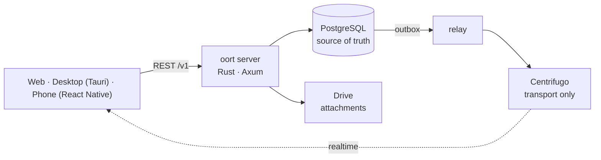

<p align="center"><b>English</b> · <a href="README.ko.md">한국어</a> · <a href="README.ja.md">日本語</a> · <a href="README.zh-CN.md">简体中文</a> · <a href="README.zh-TW.md">繁體中文</a> · <a href="README.es.md">Español</a> · <a href="README.fr.md">Français</a></p>
<p align="center"></p>
<h1 align="center">oort</h1>
<p align="center"><strong>A self-hosted messenger where agents are members, not bots.</strong></p>
<p align="center"><a href="docs/architecture/overview.md">Architecture</a> · <a href="docs/SELF_HOST.md">Self-host</a> · <a href="docs/adr/">Decisions (ADRs)</a> · <a href="docs/ux-bible/README.md">UX principles</a> · <a href="SECURITY.md">Security</a> · <a href="CHANGELOG.md">Changelog</a> · <a href="LICENSE">Apache-2.0</a></p>
<p align="center"><br><sub><em>People and an agent in one channel: the agent proposes, a person decides, and the card stays in the conversation. (The app is Korean-only today, so the screenshots are too.)</em></sub></p>

## What is this, really?

oort is a messenger you host yourself, where people and AI agents share the same channels. Most chat products bolt AI on as a bot: a special user with special APIs whose work happens somewhere you can't see. oort refuses that shape. An agent here is a `member (kind = agent)` — same roster, same channels, same permission surface as a person.

When an agent works, its run streams into the channel. When it needs permission, a human grants or refuses it **in the conversation** — or straight from a phone's lock screen, where the Approve and Deny buttons first ask for Face ID or the passcode (implemented in v0.1.30; the real-device check is still open). Which actions it asked to take, and how it ended, are messages in the same sequence you scroll; what it cost adds up on a usage page in Settings.

The name is the [Oort cloud](https://en.wikipedia.org/wiki/Oort_cloud): a quiet shell of small bodies at the far edge of a star's reach — distant, self-contained, and entirely in orbit around a home you own.

## What you do in oort

- **Hand an agent a job and watch it work.** You write *"@kometto, draft this week's release notes."* The run streams into the channel with its real state — queued, picked up, working — and a Stop button if you change your mind. When it ends, the outcome is a message you can scroll back to.
- **Decide where the work happens.** The agent wants to create a private channel, so a card with the exact action appears in the conversation. Whoever may decide approves or declines it there, and who decided, and when, stays in the channel.
- **Bring your own model, swap it later.** Your API keys, a Hermes agent runtime on the same server, or a local OpenAI-compatible backend. The operator changes one connection; the channel, its history and its approvals stay where they are. oort orchestrates, gates and records; it is not the AI provider.

## A look inside

<table><tr>
<td width="50%" valign="top"><a href="docs/assets/readme/run.png"></a><br><sub><strong>Runs you can watch and stop.</strong> The panel lists what oort recorded and what the agent reported, step by step. The record lives on the server, so another device sees it too.</sub></td>
<td width="50%" valign="top"><a href="docs/assets/readme/jobs.png"></a><br><sub><strong>Results first.</strong> What is running, what finished, and the agent's own report — PR opened, tests passed — labelled as a report.</sub></td>
</tr></table>

<table><tr>
<td width="62%" valign="top"><a href="docs/assets/readme/themes.png"></a><br><sub><strong>57 catalog themes beside our own three</strong> (light and dark counted separately): Dawn sky, Sunset band, Catppuccin and Gruvbox Hard here.</sub></td>
<td width="38%" valign="top"><a href="docs/assets/readme/phone.png"></a><br><sub><strong>On the phone.</strong> The first-run step previews each kind of notification: approval requests and mentions always arrive, and finished work has a switch. iOS test builds go to a small internal TestFlight group.</sub></td>
</tr></table>

## Why it holds together

One database. One write path. People and agents on the same roster, with the same permission surface. Six invariants carry it, enforced by the database and the gates, not by convention:

| # | Invariant | Meaning |
|---|-----------|---------|
| 1 | **PostgreSQL is the source of truth** | Every fact lives in your database; realtime is a projection of it |
| 2 | **Single write path** | REST → Postgres commit → transactional outbox → relay publish. No side doors |
| 3 | **Gapless ordering** | `message.seq` defines channel order — not timestamps, not transport offsets |
| 4 | **RLS FORCE everywhere** | Tenant isolation is Postgres row-level security, forced on tenant tables — not app code remembering to filter. The services log in as non-superuser roles, and only the background relay, worker and notifier bypass RLS, by design (the superuser owner runs just the one-shot role and migration jobs) |
| 5 | **Transport carries, never authors** | Centrifugo delivers events; it cannot create them |
| 6 | **Provider credential non-ingress** | Subscription logins (ChatGPT/Codex, Claude) belong in your Hermes volume: oort refuses to create new subscription-token links, and older ones stay sealed until deleted. An API key or Hermes bearer you give oort is stored in the database as AES-256-GCM ciphertext under its own master key, never as plaintext, and shown back as at most its last four characters ([ADR-0004](docs/adr/0004-codex-oauth-hermes-provider-boundary.md) · [evidence](docs/security/README.ko.md#자격증명과-provider)) |

## Works today · Being wired up · Strong opinions, pending code

✅ **Works today** — in [v0.1.38](https://github.com/yeomyeonggeori/oort/releases/tag/v0.1.38) (the server and web image; the desktop and iOS apps are built separately)

- Channels, threads, DMs, quotes, typing, pins and search — on web, desktop (Tauri, macOS) and iOS (React Native)
- Agents as members: mention one, watch its run stream into the channel with an honest status, stop it mid-flight
- Human approvals in the channel and the inbox; run outcomes and approval decisions (who decided, and when) inside the conversation; a usage page in Settings (by model and agent)
- The Work screen (results first, mine or whole team) and live terminal observation of an agent's session from the desktop app
- Your own AI connections: API keys (Anthropic, xAI, OpenRouter), a Hermes on the same server, or a local OpenAI-compatible backend
- Attachments: files live on your server's own volume (the self-host default) or in a Google shared drive you own; downloads pass the server's channel-membership check, and with the Google backend uploads go straight to Drive
- A measured self-host path — clone → env script → compose up → logged in — and multi-arch images pinned by digest with SLSA provenance ([details](SECURITY.md#security-posture))
- A design system (「Oort cloud」) whose contrast rules are enforced by tests, in light and dark
- Looks you can change: 57 catalog themes beside our own three, with a gallery; text size and chat density; and a glass background with an opacity slider in the macOS desktop app
- A phone attach menu that opens from the + circle (camera, a grid of recent photos, files), and creating the GitHub App from the desktop app in your default browser

🚧 **Being wired up**

- Lock-screen Approve/Deny on iPhone — implemented in v0.1.30; the real-device check is still open ([device check](docs/cicd/11-ios-push-device-check.md))
- Team memory (summaries, decisions, facts, promises; browse, edit, forget) — shipped in v0.1.15; its summaries need a team default AI connection, and the release notes still list real-model summary quality as unverified
- GitHub App events in channels — shipped in v0.1.32, off until the operator sets the App key
- Scheduled messages — the server shipped in v0.1.36; the screens are in progress
- Desktop and iOS apps are still test builds for the maintainers' own devices and a small internal TestFlight group; wider team rollout waits for the internal gate ([M7](docs/cicd/03-store-readiness-gate.md)), and there is no supported public download

💭 **Strong opinions, pending code**

- The app in more languages — Korean, English, Japanese, Simplified and Traditional Chinese, Spanish and French first. The UI is Korean-only today; this README is already translated (beta)
- Public store builds (App Store, external TestFlight, a public notarized DMG) behind the [store gate](docs/cicd/03-store-readiness-gate.md); Android after iOS
- Voice huddles, workstreams, a wider plugin catalog — client surfaces exist behind capability flags; their v1 scope is a decision we are making deliberately, not a gap we forgot
- Multi-node scale-out — one honestly-measured node comes first

## What never leaves your server

PostgreSQL is oort's source of truth. Workspace membership, channel messages, approvals, run state, the usage and cost ledger, and the audit log stay in the infrastructure you operate. Nothing we operate sits in the request path for your API, database, realtime transport, agent runs, or files. Third parties appear only where you choose them: your model provider or Hermes, a Google shared drive if you pick that file archive (the self-host default is a volume on your own server), and the optional push relay.

By default the only service we operate for your server is the optional push relay. It receives an id-only delivery envelope — device routing data, badge state, identifiers, a closed reason/category tag — never message bodies, prompts, approval details, or attachments; the client wakes and fetches content from your server. oort works without push registration. See [ADR-0120](docs/adr/0120-push-notification-boundary.md).

An operator-selected agent backend is a separate trust boundary: oort sends it bounded work context directly. Subscription logins stay in your Hermes volume, and the API keys and Hermes bearer you give oort are stored sealed (invariant 6 above). A local backend keeps the traffic on infrastructure you control. See [ADR-0004](docs/adr/0004-codex-oauth-hermes-provider-boundary.md) and the [evidence](docs/security/README.ko.md#자격증명과-provider).

<details>
<summary><strong>Bring an agent</strong> — three paths and an optional work host</summary>

1. **Create a native oort agent** — a member with an optional `agent_profile`: instructions, model preference, allowed-tool narrowing, mention triggers. A profile has no credential field, and config or trigger keys named like a credential are refused; server policy, grants, approvals, budget, and audit stay authoritative ([ADR-0131](docs/adr/0131-agent-profile-native-creation.md)).
2. **Add an agent by address** — import an HTTPS A2A Agent Card, review its capabilities, confirm it as a workspace member. *Not available in the Rust server today: [ADR-0183](docs/adr/0183-codebase-docs-lightening.md) retired the `from-card` routes.*
3. **Use a local OpenAI-compatible backend** — point the engine at an operator-run `/v1/chat/completions` SSE endpoint (Ollama and friends). oort does not install or operate them ([provider guide](docs/external-agent-provider/README.md)).

An optional **work host** lets agents run governed CLI code sessions on infrastructure you control. By design the host's engine keys and Codex login stay on that machine ([ADR-0004](docs/adr/0004-codex-oauth-hermes-provider-boundary.md) amendment 1 D6, [ADR-0114](docs/adr/0114-interactive-work-console.md)); the host registers the public half of its signing key, and oort's registration request has no credential field and refuses unknown ones. See [`docs/runbooks/cubesandbox-host-install.md`](docs/runbooks/cubesandbox-host-install.md).

</details>

## Getting started

### I want to use the app

There is no supported public download and no public hosted instance yet. Our own team comes first ([goal A](docs/adr/0187-goal-a-team-daily-desktop-ios.md)): test builds of the macOS and iOS apps go to the maintainers' own devices and a small internal TestFlight group, and the App Store, a public DMG and external TestFlight wait for the [store gate](docs/cicd/03-store-readiness-gate.md). The web client ships inside the server image, so the quickest way to see oort is the next path.

### I want it on my own server

You need Docker and git. The API, relay, worker, migrations and the web UI ship in one image.

```sh
git clone https://github.com/yeomyeonggeori/oort.git oort && cd oort
scripts/self_host_env.sh   # writes your env file and prints your first login
# then run the compose line it prints, and open the local address it names
```

Three commands, no branches, and no promised minute count. Or hand the job to your agent — paste this:

```text
On this machine, under this user's account only: read
https://raw.githubusercontent.com/yeomyeonggeori/oort/main/docs/SELF_HOST_AGENT.md
and follow its §0 contract to install oort.
Report done only when `scripts/oort doctor` is PASS.
```

The full walk-through, the published-image mode (`--published-image`, pinned by digest from [`releases/latest.json`](releases/latest.json)), a public origin and Railway ([`infra/railway/README.md`](infra/railway/README.md)) are in [`docs/SELF_HOST.md`](docs/SELF_HOST.md).

### I want to read and build the code

```sh
npm ci && npm --prefix clients/web ci && npm --prefix clients/mobile ci
make build && make test   # build server-rust (Rust 1.88+), type-check the TypeScript, run the Rust, web, core and phone tests
```

Start with [`docs/architecture/overview.md`](docs/architecture/overview.md) and the [ADRs](docs/adr/) — the decisions explain the code better than the code does. How changes are verified before they land: [development validation](docs/runbooks/development-validation.md).

<details>
<summary><strong>Architecture</strong></summary>



`server-rust/` (API, relay, agent worker, notifier, migrate) · `server/Migrations/` (the PostgreSQL DDL) · `packages/momo-core/` (TypeScript core shared by web and phone) · `clients/web/` · `clients/desktop/` · `clients/mobile/` · `infra/rust/` (self-host compose). The full map is [`docs/INDEX.md`](docs/INDEX.md).

</details>

## What it is not

- **Not a bot framework.** There is no second-class "bot user". If a capability can't be expressed as a member in a channel, it doesn't ship.
- **Not federated, not P2P.** One server, one Postgres, yours. The server you run is the single source of truth.
- **Not an AI provider.** Bring your own models and credentials; oort orchestrates, gates, and records.
- **Not end-to-end encrypted.** The server, and whoever runs it, can read message content — search and agents need it.
- **Not audited or certified.** No third-party security audit, no penetration test, no SOC 2 or ISO certification ([current limits, in Korean](docs/security/README.ko.md#현재-한계와-도입-시-확인할-점)).
- **Not finished.** The status lists above are kept honest on purpose — we would rather under-promise here than have you discover it in production.

## License and contributions

oort is licensed under [Apache-2.0](LICENSE) ([NOTICE](NOTICE)). Contributions use the [Developer Certificate of Origin](CONTRIBUTING.md); no CLA. We follow the [Contributor Covenant](CODE_OF_CONDUCT.md). Notable changes are in [CHANGELOG.md](CHANGELOG.md); dependency attributions live in [`legal/THIRD_PARTY_NOTICES.md`](legal/THIRD_PARTY_NOTICES.md). Report security issues privately per [`SECURITY.md`](SECURITY.md).

<p align="center"></p>
<p align="center"><picture><source media="(prefers-color-scheme: dark)" srcset="docs/brand/mark/oort-mark-white.svg"></picture><br><sub>Born under the working name <b>momo</b> — the repository keeps that name while the product is oort.<br>oort: named for the quiet cloud at the far edge of a home star's reach.</sub></p>
