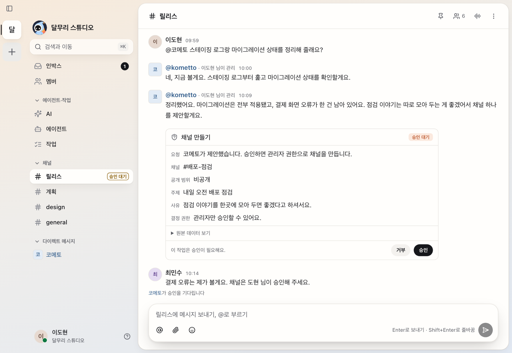
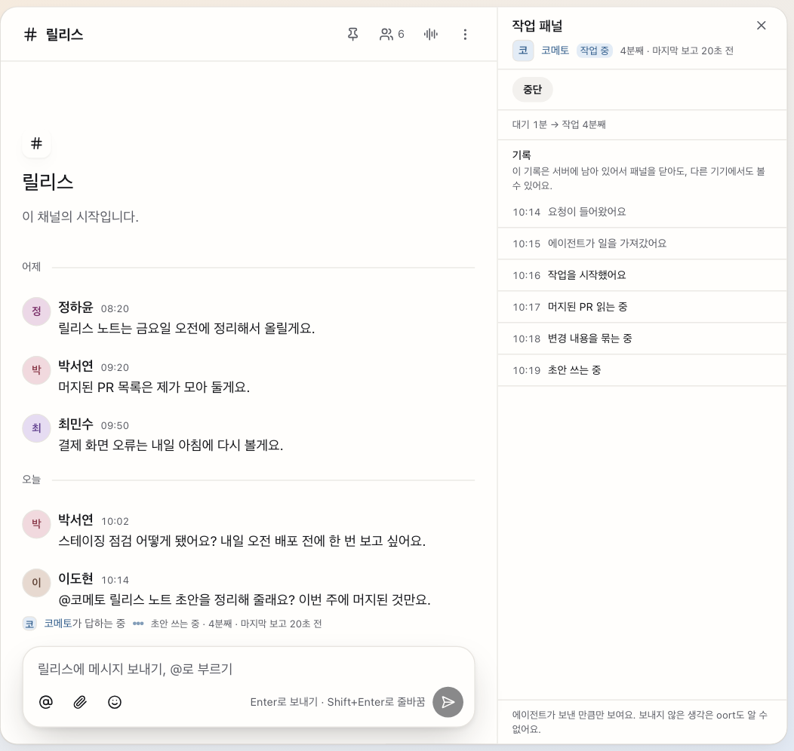
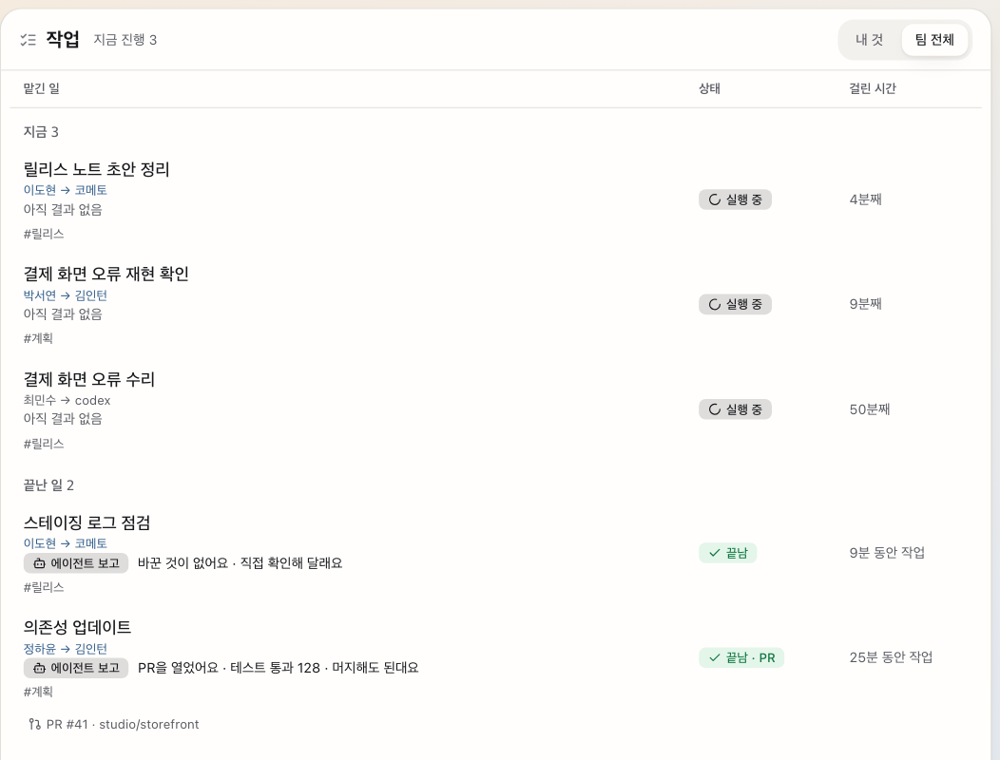
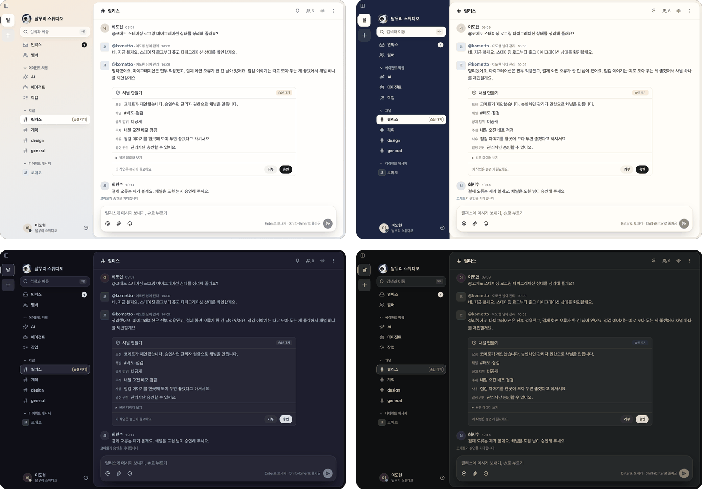
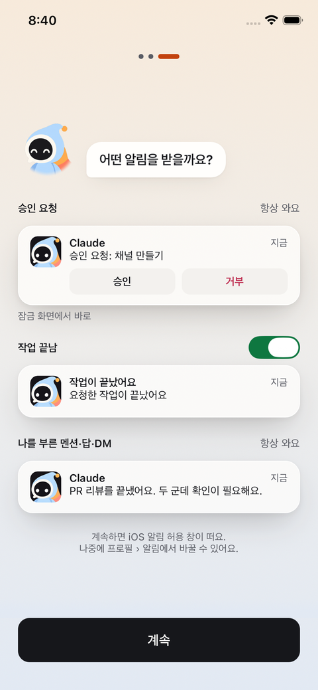
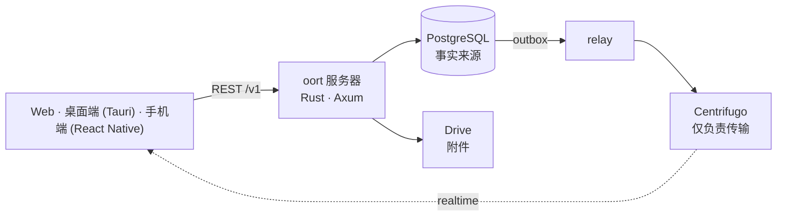

<p align="center"><a href="README.md">English</a> · <a href="README.ko.md">한국어</a> · <a href="README.ja.md">日本語</a> · <b>简体中文</b> · <a href="README.zh-TW.md">繁體中文</a> · <a href="README.es.md">Español</a> · <a href="README.fr.md">Français</a></p>
<p align="center"><sub>翻译（测试版）— 以英文版为准。</sub></p>
<p align="center"></p>
<h1 align="center">oort</h1>
<p align="center"><strong>智能体是成员而不是机器人的自托管即时通讯。</strong></p>
<p align="center"><a href="docs/architecture/overview.md">架构</a> · <a href="docs/SELF_HOST.md">自托管</a> · <a href="docs/adr/">决策记录（ADR）</a> · <a href="docs/ux-bible/README.md">UX 原则</a> · <a href="SECURITY.md">安全</a> · <a href="CHANGELOG.md">更新日志</a> · <a href="LICENSE">Apache-2.0</a></p>
<p align="center"><br><sub><em>同一个频道里有人，也有智能体：智能体提出建议，人来决定，卡片留在对话里。（应用目前只有韩文界面，所以截图也是韩文。）</em></sub></p>

## 这到底是什么？

oort 是你自己托管的即时通讯工具，人和 AI 智能体共用同样的频道。大多数聊天产品把 AI 当作机器人附加上去：一个拥有特殊 API 的特殊用户，它的工作发生在你看不见的地方。oort 拒绝这种形态。这里的智能体是 `member (kind = agent)`——同样的成员名册、同样的频道、同样的权限面，和人一样。

智能体工作时，它的运行会流入频道。需要权限时，由人**在对话里**批准或拒绝——也可以直接在手机锁屏上操作，那里的“批准”和“拒绝”按钮会先要求 Face ID 或设备密码（已在 v0.1.30 实现，真机验证仍未完成）。请求执行过哪些操作、如何结束，都是你滚动浏览的同一条时间线里的消息；花了多少钱，则汇总在设置里的用量页面。

名字取自[奥尔特云](https://zh.wikipedia.org/wiki/奥尔特云)：位于恒星影响范围最边缘的一圈安静的小天体——遥远、自成一体，完全环绕着一个属于你的家。

## 在 oort 里你能做什么

- **把一项任务交给智能体，并看着它工作。** 你写下“@kometto，起草本周的发布说明。”运行会带着真实状态——排队中、已领取、工作中——流入频道，如果你改主意了还有“停止”按钮。结束后，结果是一条可以往回翻看的消息。
- **在工作发生的地方做决定。** 智能体想创建一个私有频道，对话里就会出现一张写明确切操作的卡片。有权决定的人在那里批准或拒绝，谁在何时做的决定会留在频道里。
- **自带模型，之后随时更换。** 你自己的 API 密钥、同一台服务器上的 Hermes 智能体运行时，或本地兼容 OpenAI 的后端。运维者只改一个连接；频道、历史和审批原封不动。oort 负责编排、把关和记录；它不是 AI 提供方。

## 内部一瞥

<table><tr>
<td width="50%" valign="top"><a href="docs/assets/readme/run.png"></a><br><sub><strong>看得见、停得下的运行。</strong> 面板按步骤列出 oort 记录的内容和智能体上报的内容。记录保存在服务器上，所以换一台设备也能看到。</sub></td>
<td width="50%" valign="top"><a href="docs/assets/readme/jobs.png"></a><br><sub><strong>结果优先。</strong> 正在运行的、已完成的，以及智能体自己的报告——已开 PR、测试通过——并标注为“报告”。</sub></td>
</tr></table>

<table><tr>
<td width="62%" valign="top"><a href="docs/assets/readme/themes.png"></a><br><sub><strong>在我们自带的三个主题之外，还有 57 个目录主题</strong>（浅色和深色分开计数）：这里是 Dawn sky、Sunset band、Catppuccin 和 Gruvbox Hard。</sub></td>
<td width="38%" valign="top"><a href="docs/assets/readme/phone.png"></a><br><sub><strong>在手机上。</strong> 首次启动的步骤会预览每一类通知：审批请求和提及始终会送达，“工作完成”有一个开关。iOS 测试构建发给一个小型 TestFlight 内部分组。</sub></td>
</tr></table>

## 为什么它不会散架

一个数据库。一条写入路径。人和智能体在同一份名册上，拥有同样的权限面。六条不变量撑起这一切，由数据库和门禁来保证，而不是靠约定：

| # | 不变量 | 含义 |
|---|--------|------|
| 1 | **PostgreSQL 是事实来源** | 所有事实都存放在你的数据库里；实时只是它的投影 |
| 2 | **唯一写入路径** | REST → Postgres 提交 → 事务性发件箱 → relay 发布。没有旁门 |
| 3 | **无空洞的顺序** | 频道的顺序由 `message.seq` 决定——不是时间戳，也不是传输偏移量 |
| 4 | **处处 RLS FORCE** | 租户隔离是对租户表强制开启的 Postgres 行级安全——而不是指望应用代码记得去过滤。各服务以非超级用户角色登录，只有后台的 relay、worker 和 notifier 按设计绕过 RLS（作为超级用户的所有者角色只运行一次性的角色创建和迁移作业） |
| 5 | **传输只负责搬运，从不创作** | Centrifugo 投递事件，但无法创建事件 |
| 6 | **不接收提供方凭据** | 订阅登录（ChatGPT/Codex、Claude）应放在你自己的 Hermes 卷里：oort 拒绝创建新的订阅令牌链接，旧的链接在删除前保持封存。你交给 oort 的 API 密钥或 Hermes bearer，会以 AES-256-GCM 密文的形式、用它自己的主密钥存入数据库，绝不以明文保存，回显时最多只显示最后四个字符（[ADR-0004](docs/adr/0004-codex-oauth-hermes-provider-boundary.md) · [依据](docs/security/README.ko.md#자격증명과-provider)） |

## 现已可用 · 接线中 · 主张已定，代码未到

✅ **现已可用** — 在 [v0.1.38](https://github.com/yeomyeonggeori/oort/releases/tag/v0.1.38) 中（服务器和 Web 镜像；桌面端和 iOS 应用单独构建）

- 频道、线程、私信、引用、输入中提示、置顶和搜索——支持 Web、桌面端（Tauri，macOS）和 iOS（React Native）
- 作为成员的智能体：@ 它，看它的运行以诚实的状态流入频道，可随时中途停止
- 频道和收件箱里的人工审批；运行结果和审批决定（谁在何时决定）都在对话里，设置里还有按模型、按智能体的用量页面
- “工作”界面（结果优先，看自己的或整个团队的），以及在桌面应用里实时观察智能体会话的终端
- 你自己的 AI 连接：API 密钥（Anthropic、xAI、OpenRouter）、同一台服务器上的 Hermes，或本地兼容 OpenAI 的后端
- 附件：文件存放在你服务器自己的卷上（自托管默认），或你自己的 Google 共享云端硬盘里；下载要通过服务器的频道成员资格检查，使用 Google 后端时上传直接发往 Drive
- 经过实测的自托管路径——clone → env 脚本 → compose up → 登录——以及按 digest 固定、带 SLSA provenance 的多架构镜像（[详情](SECURITY.md#security-posture)）
- 由测试守住对比度规则的设计系统（“Oort cloud”），支持浅色和深色
- 可以自定义的外观：在我们自带的三个主题之外，还有 57 个目录主题和主题库、文字大小与聊天密度，以及 macOS 桌面端的毛玻璃背景（可调不透明度）
- 手机端附件菜单（从 + 圆钮展开的卡片：相机、最近照片网格、文件），以及在桌面端用默认浏览器创建 GitHub App

🚧 **接线中**

- iPhone 锁屏上的批准/拒绝——已在 v0.1.30 实现；真机验证仍未完成（[设备检查](docs/cicd/11-ios-push-device-check.md)）
- 团队记忆（摘要、决定、事实、承诺；浏览、编辑、遗忘）——已随 v0.1.15 发布；其摘要需要团队默认的 AI 连接，发布说明仍把真实模型下的摘要质量列为未验证
- 频道里的 GitHub App 事件——已随 v0.1.32 发布，在运维者设置 App 密钥之前保持关闭
- 定时消息——服务端已随 v0.1.36 发布，界面仍在制作中
- 桌面端和 iOS 应用目前仍是面向维护者自己的设备和小型 TestFlight 内部分组的测试构建；面向整个团队的分发要等内部门禁（[M7](docs/cicd/03-store-readiness-gate.md)），目前没有受支持的公开下载

💭 **主张已定，代码未到**

- 更多语言的应用——首批是韩文、英文、日文、简体中文、繁体中文、西班牙文和法文。目前界面只有韩文；这份 README 已经有译文了（测试版）
- 面向商店的公开构建（App Store、外部 TestFlight、公开的已公证 DMG）要等[商店门禁](docs/cicd/03-store-readiness-gate.md)；Android 排在 iOS 之后
- 语音 huddle、工作流、更丰富的插件目录——客户端界面已存在，但藏在 capability 开关之后；它们的 v1 范围是我们正在有意识地做的决定，而不是被遗忘的缺口
- 多节点横向扩展——先把一个节点老老实实测清楚

## 不会离开你服务器的东西

PostgreSQL 是 oort 的事实来源。工作区成员关系、频道消息、审批、运行状态、用量与费用账本，以及审计日志，都留在你自己运维的基础设施里。我们运营的任何东西都不在你的 API、数据库、实时传输、智能体运行或文件的请求路径上。第三方只出现在你自己选择的地方：你的模型提供方或 Hermes、你若选择该文件归档时的 Google 共享云端硬盘（自托管默认是你自己服务器上的一个卷），以及可选的推送中继。

默认情况下，我们为你的服务器运营的唯一服务就是可选的推送中继。它只接收仅含 id 的投递信封——设备路由数据、角标状态、标识符、一个封闭的 reason/category 标签——绝不接收消息正文、提示词、审批细节或附件；客户端被唤醒后，从你的服务器获取内容。不注册推送，oort 也能工作。见 [ADR-0120](docs/adr/0120-push-notification-boundary.md)。

运维者选定的智能体后端是一道独立的信任边界：oort 把受限的工作上下文直接发给它。订阅登录留在你的 Hermes 卷里，你交给 oort 的 API 密钥和 Hermes bearer 以封存形式保存（见上面的不变量 6）。本地后端则把流量留在你掌控的基础设施上。见 [ADR-0004](docs/adr/0004-codex-oauth-hermes-provider-boundary.md) 和[依据](docs/security/README.ko.md#자격증명과-provider)。

<details>
<summary><strong>接入智能体</strong> — 三条路径和可选的工作主机</summary>

1. **创建 oort 原生智能体**——一个带可选 `agent_profile` 的成员：指令、模型偏好、允许工具的收窄、@ 触发器。配置档案里没有凭据字段，名字像凭据的配置键或触发键会被拒绝；服务器策略、授权、审批、预算和审计始终具有权威（[ADR-0131](docs/adr/0131-agent-profile-native-creation.md)）。
2. **按地址添加智能体**——导入 HTTPS 的 A2A Agent Card，查看它的能力，再确认为工作区成员。*目前 Rust 服务器不提供：[ADR-0183](docs/adr/0183-codebase-docs-lightening.md) 已撤掉 `from-card` 路由。*
3. **使用本地兼容 OpenAI 的后端**——让引擎指向运维者运行的 `/v1/chat/completions` SSE 端点（Ollama 之类）。oort 不安装也不运维它们（[提供方指南](docs/external-agent-provider/README.md)）。

可选的**工作主机**让智能体在你掌控的基础设施上运行受管控的 CLI 代码会话。按设计，主机的引擎密钥和 Codex 登录留在那台机器上（[ADR-0004](docs/adr/0004-codex-oauth-hermes-provider-boundary.md) 补遗 1 D6、[ADR-0114](docs/adr/0114-interactive-work-console.md)）；主机只登记其签名密钥的公开一半，oort 的登记请求里没有凭据字段，并会拒绝未知字段。见 [`docs/runbooks/cubesandbox-host-install.md`](docs/runbooks/cubesandbox-host-install.md)。

</details>

## 开始使用

### 我只想试试应用

目前还没有受支持的公开下载，也没有公开托管的实例。我们自己的团队优先（[目标 A](docs/adr/0187-goal-a-team-daily-desktop-ios.md)）：macOS 和 iOS 应用的测试构建只发给维护者自己的设备和一个小型 TestFlight 内部分组，App Store、公开 DMG 和外部 TestFlight 要等[商店门禁](docs/cicd/03-store-readiness-gate.md)。Web 客户端就在服务器镜像里，所以最快看到 oort 的办法是下一条路径。

### 我想放在自己的服务器上

你只需要 Docker 和 git。API、relay、worker、迁移和 Web UI 都在同一个镜像里。

```sh
git clone https://github.com/yeomyeonggeori/oort.git oort && cd oort
scripts/self_host_env.sh   # 写出你的 env 文件并打印首次登录信息
# 然后运行它打印出的 compose 命令行，打开它指明的本地地址
```

三条命令，没有岔路，也不承诺耗时。也可以把这件事交给你的智能体——粘贴下面这段：

```text
在这台机器上，只在这个用户的账户下：
读取 https://raw.githubusercontent.com/yeomyeonggeori/oort/main/docs/SELF_HOST_AGENT.md ，
并按其 §0 的约定安装 oort。
只有当 `scripts/oort doctor` 为 PASS 时才报告完成。
```

完整的操作流程、已发布镜像模式（`--published-image`，按 [`releases/latest.json`](releases/latest.json) 里的 digest 固定）、公网入口和 Railway（[`infra/railway/README.md`](infra/railway/README.md)）见 [`docs/SELF_HOST.md`](docs/SELF_HOST.md)。

### 我想从代码构建

```sh
npm ci && npm --prefix clients/web ci && npm --prefix clients/mobile ci
make build && make test   # 构建 server-rust（Rust 1.88+）、TypeScript 类型检查、运行 Rust、Web、core 和手机端测试
```

先读 [`docs/architecture/overview.md`](docs/architecture/overview.md) 和 [ADR](docs/adr/)——这些决定比代码更能解释代码。变更落地前如何验证，见[开发验证](docs/runbooks/development-validation.md)。

<details>
<summary><strong>架构</strong></summary>



`server-rust/`（API、relay、agent worker、notifier、migrate）· `server/Migrations/`（PostgreSQL DDL）· `packages/momo-core/`（Web 和手机端共用的 TypeScript 核心）· `clients/web/` · `clients/desktop/` · `clients/mobile/` · `infra/rust/`（自托管 compose）。完整地图见 [`docs/INDEX.md`](docs/INDEX.md)。

</details>

## oort 不是什么

- **不是机器人框架。** 没有二等公民的“机器人用户”。如果一项能力无法表达为频道里的一个成员，它就不会发布。
- **不是联邦式，也不是 P2P。** 一台服务器，一个 Postgres，归你所有。你运行的服务器是唯一的事实来源。
- **不是 AI 提供方。** 模型和凭据请自带；oort 负责编排、把关和记录。
- **不是端到端加密。** 服务器，以及运行它的人，可以读取消息内容——搜索和智能体都需要这一点。
- **没有经过审计或认证。** 没有第三方安全审计，没有渗透测试，没有 SOC 2 或 ISO 认证（[当前局限，韩文](docs/security/README.ko.md#현재-한계와-도입-시-확인할-점)）。
- **还没做完。** 上面的状态清单是有意写得诚实的——我们宁可在这里少承诺，也不愿你在生产环境里才发现。

## 许可与贡献

oort 采用 [Apache-2.0](LICENSE)（[NOTICE](NOTICE)）许可。贡献遵循 [Developer Certificate of Origin](CONTRIBUTING.md)，没有 CLA。我们遵循 [Contributor Covenant](CODE_OF_CONDUCT.md)。重要变更记录在 [CHANGELOG.md](CHANGELOG.md)；依赖项的归属说明在 [`legal/THIRD_PARTY_NOTICES.md`](legal/THIRD_PARTY_NOTICES.md)。请按 [`SECURITY.md`](SECURITY.md) 私下报告安全问题。

<p align="center"></p>
<p align="center"><picture><source media="(prefers-color-scheme: dark)" srcset="docs/brand/mark/oort-mark-white.svg"></picture><br><sub>诞生于工作代号 <b>momo</b> 之下——产品叫 oort 的今天，仓库仍沿用这个名字。<br>oort：取名于家园恒星影响范围边缘的那片安静的云。</sub></p>
