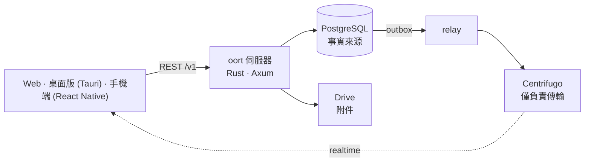

<p align="center"><a href="README.md">English</a> · <a href="README.ko.md">한국어</a> · <a href="README.ja.md">日本語</a> · <a href="README.zh-CN.md">简体中文</a> · <b>繁體中文</b> · <a href="README.es.md">Español</a> · <a href="README.fr.md">Français</a></p>
<p align="center"><sub>翻譯（測試版）— 以英文版為準。</sub></p>
<p align="center"></p>
<h1 align="center">oort</h1>
<p align="center"><strong>代理是成員、而不是機器人的自架通訊軟體。</strong></p>
<p align="center"><a href="docs/architecture/overview.md">架構</a> · <a href="docs/SELF_HOST.md">自架</a> · <a href="docs/adr/">決策紀錄（ADR）</a> · <a href="docs/ux-bible/README.md">UX 原則</a> · <a href="SECURITY.md">安全性</a> · <a href="CHANGELOG.md">變更紀錄</a> · <a href="LICENSE">Apache-2.0</a></p>
<p align="center"><br><sub><em>同一個頻道裡有人，也有代理：代理提出建議，由人決定，卡片留在對話裡。（應用程式目前只有韓文介面，所以截圖也是韓文。）</em></sub></p>

## 這到底是什麼？

oort 是你自己架設的通訊軟體，人與 AI 代理共用同樣的頻道。多數聊天產品把 AI 當成機器人外掛上去：一個擁有特殊 API 的特殊使用者，它的工作發生在你看不見的地方。oort 拒絕這種形態。這裡的代理是 `member (kind = agent)`——同樣的成員名冊、同樣的頻道、同樣的權限面，和人一樣。

代理工作時，它的執行會流入頻道。需要權限時，由人**在對話裡**核准或拒絕——也可以直接在手機鎖定畫面上操作，那裡的「核准」與「拒絕」按鈕會先要求 Face ID 或裝置密碼（已在 v0.1.30 實作，實機驗證仍未完成）。請求執行過哪些操作、如何結束，都是你捲動瀏覽的同一條時間軸裡的訊息；花了多少錢，則彙總在設定裡的用量頁面。

名字取自[歐特雲](https://zh.wikipedia.org/zh-tw/奥尔特云)：位於恆星影響範圍最邊緣的一圈安靜的小天體——遙遠、自成一體，完全環繞著一個屬於你的家。

## 在 oort 裡你能做什麼

- **把一項任務交給代理，並看著它工作。** 你寫下「@kometto，起草本週的發布說明。」執行會帶著真實狀態——排隊中、已領取、工作中——流入頻道，如果你改變主意，還有「停止」按鈕。結束後，結果是一則可以往回翻看的訊息。
- **在工作發生的地方做決定。** 代理想建立一個私人頻道，對話裡就會出現一張寫明確切操作的卡片。有權決定的人在那裡核准或拒絕，誰在何時做的決定會留在頻道裡。
- **自帶模型，之後隨時更換。** 你自己的 API 金鑰、同一台伺服器上的 Hermes 代理執行環境，或本機相容 OpenAI 的後端。維運者只改一個連線；頻道、歷史與核准原封不動。oort 負責編排、把關與記錄；它不是 AI 供應商。

## 內部一瞥

<table><tr>
<td width="50%" valign="top"><a href="docs/assets/readme/run.png"></a><br><sub><strong>看得見、停得下的執行。</strong> 面板依步驟列出 oort 記錄的內容與代理回報的內容。紀錄保存在伺服器上，所以換一台裝置也看得到。</sub></td>
<td width="50%" valign="top"><a href="docs/assets/readme/jobs.png"></a><br><sub><strong>結果優先。</strong> 正在執行的、已完成的，以及代理自己的回報——已開 PR、測試通過——並標示為「回報」。</sub></td>
</tr></table>

<table><tr>
<td width="62%" valign="top"><a href="docs/assets/readme/themes.png"></a><br><sub><strong>在我們自有的三個主題之外，還有 57 個目錄主題</strong>（淺色與深色分開計算）：這裡是 Dawn sky、Sunset band、Catppuccin 與 Gruvbox Hard。</sub></td>
<td width="38%" valign="top"><a href="docs/assets/readme/phone.png"></a><br><sub><strong>在手機上。</strong> 首次啟動的步驟會預覽每一類通知：核准請求與提及一律會送達，「工作完成」有一個開關。iOS 測試建置版本發給一個小型 TestFlight 內部群組。</sub></td>
</tr></table>

## 為什麼它不會散架

一個資料庫。一條寫入路徑。人與代理在同一份名冊上，擁有同樣的權限面。六條不變式撐起這一切，由資料庫與關卡來保證，而不是靠慣例：

| # | 不變式 | 意義 |
|---|--------|------|
| 1 | **PostgreSQL 是事實來源** | 所有事實都存放在你的資料庫裡；即時只是它的投影 |
| 2 | **唯一寫入路徑** | REST → Postgres 提交 → 交易式 outbox → relay 發布。沒有旁門 |
| 3 | **沒有空隙的順序** | 頻道的順序由 `message.seq` 決定——不是時間戳記，也不是傳輸位移 |
| 4 | **處處 RLS FORCE** | 租戶隔離是對租戶資料表強制開啟的 Postgres 列級安全性——而不是指望應用程式碼記得去過濾。各服務以非超級使用者角色登入，只有背景的 relay、worker 與 notifier 依設計繞過 RLS（身為超級使用者的擁有者角色只執行一次性的角色建立與遷移作業） |
| 5 | **傳輸只負責搬運，從不創作** | Centrifugo 投遞事件，但無法建立事件 |
| 6 | **不接收供應商憑證** | 訂閱登入（ChatGPT/Codex、Claude）應放在你自己的 Hermes 磁碟區裡：oort 拒絕建立新的訂閱權杖連結，舊的連結在刪除前保持封存。你交給 oort 的 API 金鑰或 Hermes bearer，會以 AES-256-GCM 密文的形式、用它自己的主金鑰存入資料庫，絕不以明文儲存，回顯時最多只顯示最後四個字元（[ADR-0004](docs/adr/0004-codex-oauth-hermes-provider-boundary.md) · [依據](docs/security/README.ko.md#자격증명과-provider)） |

## 現已可用 · 接線中 · 主張已定，程式未到

✅ **現已可用** — 在 [v0.1.39](https://github.com/yeomyeonggeori/oort/releases/tag/v0.1.39) 中（伺服器與 Web 映像檔；桌面版與 iOS 應用程式另外建置）

- 頻道、討論串、私訊、引用、輸入中提示、釘選與搜尋——支援 Web、桌面版（Tauri，macOS）與 iOS（React Native）
- 作為成員的代理：@ 它，看它的執行以誠實的狀態流入頻道，可隨時中途停止
- 頻道與收件匣裡的人工核准；執行結果和核准決定（誰在何時決定）都在對話裡，設定裡還有依模型、依代理的用量頁面
- 「工作」畫面（結果優先，看自己的或整個團隊的），以及在桌面版應用程式裡即時觀察代理工作階段的終端機
- 你自己的 AI 連線：API 金鑰（Anthropic、xAI、OpenRouter）、同一台伺服器上的 Hermes，或本機相容 OpenAI 的後端
- 附件：檔案存放在你伺服器自己的磁碟區上（自架預設），或你自己的 Google 共用雲端硬碟裡；下載要通過伺服器的頻道成員資格檢查，使用 Google 後端時上傳直接送往 Drive
- 經過實測的自架路徑——clone → env 指令碼 → compose up → 登入——以及依 digest 固定、附有 SLSA provenance 的多架構映像檔（[詳情](SECURITY.md#security-posture)）
- 由測試守住對比規則的設計系統（「Oort cloud」），支援淺色與深色
- 可以自訂的外觀：在我們自有的三個主題之外，還有 57 個目錄主題與主題庫、文字大小與聊天密度，以及 macOS 桌面版的毛玻璃背景（可調整不透明度）
- 手機端附件選單（從 + 圓鈕展開的卡片：相機、最近照片格狀檢視、檔案），以及在桌面版用預設瀏覽器建立 GitHub App

🚧 **接線中**

- iPhone 鎖定畫面上的核准／拒絕——已在 v0.1.30 實作；實機驗證仍未完成（[裝置檢查](docs/cicd/11-ios-push-device-check.md)）
- 團隊記憶（摘要、決定、事實、承諾；瀏覽、編輯、遺忘）——已隨 v0.1.15 發布；其摘要需要團隊預設的 AI 連線，發布說明仍把真實模型下的摘要品質列為未驗證
- 頻道裡的 GitHub App 事件——已隨 v0.1.32 發布，在維運者設定 App 金鑰之前保持關閉
- 排程訊息——伺服器端已隨 v0.1.36 發布，畫面仍在製作中
- 桌面版與 iOS 應用程式目前仍是提供給維護者自己的裝置與小型 TestFlight 內部群組的測試建置版本；要推出給整個團隊，得等內部關卡（[M7](docs/cicd/03-store-readiness-gate.md)），目前沒有受支援的公開下載

💭 **主張已定，程式未到**

- 更多語言的應用程式——首批是韓文、英文、日文、簡體中文、繁體中文、西班牙文與法文。目前介面只有韓文；這份 README 已經有譯文了（測試版）
- 面向商店的公開建置版本（App Store、外部 TestFlight、公開的已公證 DMG）要等[商店關卡](docs/cicd/03-store-readiness-gate.md)；Android 排在 iOS 之後
- 語音 huddle、工作流程、更豐富的外掛目錄——用戶端介面已存在，但藏在 capability 開關之後；它們的 v1 範圍是我們正在有意識地做的決定，而不是被遺忘的缺口
- 多節點橫向擴充——先把一個節點老老實實測清楚

## 不會離開你伺服器的東西

PostgreSQL 是 oort 的事實來源。工作區成員關係、頻道訊息、核准、執行狀態、用量與費用帳本，以及稽核日誌，都留在你自己維運的基礎設施裡。我們營運的任何東西都不在你的 API、資料庫、即時傳輸、代理執行或檔案的請求路徑上。第三方只出現在你自己選擇的地方：你的模型供應商或 Hermes、你若選擇該檔案封存時的 Google 共用雲端硬碟（自架預設是你自己伺服器上的一個磁碟區），以及選用的推播中繼。

預設情況下，我們為你的伺服器營運的唯一服務就是選用的推播中繼。它只接收僅含 id 的投遞信封——裝置路由資料、徽章狀態、識別碼、一個封閉的 reason/category 標籤——絕不接收訊息本文、提示詞、核准細節或附件；用戶端被喚醒後，從你的伺服器取得內容。不註冊推播，oort 也能運作。見 [ADR-0120](docs/adr/0120-push-notification-boundary.md)。

維運者選定的代理後端是一道獨立的信任邊界：oort 把受限的工作脈絡直接送給它。訂閱登入留在你的 Hermes 磁碟區裡，你交給 oort 的 API 金鑰與 Hermes bearer 以封存形式儲存（見上面的不變式 6）。本機後端則把流量留在你掌控的基礎設施上。見 [ADR-0004](docs/adr/0004-codex-oauth-hermes-provider-boundary.md) 與[依據](docs/security/README.ko.md#자격증명과-provider)。

<details>
<summary><strong>接入代理</strong> — 三條路徑與選用的工作主機</summary>

1. **建立 oort 原生代理**——一個帶選用 `agent_profile` 的成員：指示、模型偏好、允許工具的收窄、@ 觸發器。設定檔裡沒有憑證欄位，名稱像憑證的設定鍵或觸發鍵會被拒絕；伺服器政策、授權、核准、預算與稽核始終具有權威（[ADR-0131](docs/adr/0131-agent-profile-native-creation.md)）。
2. **依位址新增代理**——匯入 HTTPS 的 A2A Agent Card，檢視它的能力，再確認為工作區成員。*目前 Rust 伺服器不提供：[ADR-0183](docs/adr/0183-codebase-docs-lightening.md) 已撤掉 `from-card` 路由。*
3. **使用本機相容 OpenAI 的後端**——讓引擎指向維運者執行的 `/v1/chat/completions` SSE 端點（Ollama 之類）。oort 不安裝也不維運它們（[供應商指南](docs/external-agent-provider/README.md)）。

選用的**工作主機**讓代理在你掌控的基礎設施上執行受管控的 CLI 程式碼工作階段。依設計，主機的引擎金鑰與 Codex 登入留在那台機器上（[ADR-0004](docs/adr/0004-codex-oauth-hermes-provider-boundary.md) 補遺 1 D6、[ADR-0114](docs/adr/0114-interactive-work-console.md)）；主機只登記其簽章金鑰的公開一半，oort 的登記請求裡沒有憑證欄位，並會拒絕未知欄位。見 [`docs/runbooks/cubesandbox-host-install.md`](docs/runbooks/cubesandbox-host-install.md)。

</details>

## 開始使用

### 我只想試試應用程式

目前還沒有受支援的公開下載，也沒有公開託管的實例。我們自己的團隊優先（[目標 A](docs/adr/0187-goal-a-team-daily-desktop-ios.md)）：macOS 與 iOS 應用程式的測試建置版本只發給維護者自己的裝置和一個小型 TestFlight 內部群組，App Store、公開 DMG 與外部 TestFlight 要等[商店關卡](docs/cicd/03-store-readiness-gate.md)。Web 用戶端就在伺服器映像檔裡，所以最快看到 oort 的辦法是下一條路徑。

### 我想放在自己的伺服器上

你只需要 Docker 與 git。API、relay、worker、遷移與 Web UI 都在同一個映像檔裡。

```sh
git clone https://github.com/yeomyeonggeori/oort.git oort && cd oort
scripts/self_host_env.sh   # 寫出你的 env 檔並印出首次登入資訊
# 然後執行它印出的 compose 指令，開啟它指明的本機位址
```

三條指令，沒有岔路，也不承諾耗時。也可以把這件事交給你的代理——貼上下面這段：

```text
在這台機器上，只在這個使用者的帳號下：
讀取 https://raw.githubusercontent.com/yeomyeonggeori/oort/main/docs/SELF_HOST_AGENT.md ，
並依其 §0 的約定安裝 oort。
只有當 `scripts/oort doctor` 為 PASS 時才回報完成。
```

完整的操作流程、已發布映像檔模式（`--published-image`，依 [`releases/latest.json`](releases/latest.json) 裡的 digest 固定）、公開網域與 Railway（[`infra/railway/README.md`](infra/railway/README.md)）見 [`docs/SELF_HOST.md`](docs/SELF_HOST.md)。

### 我想從原始碼建置

```sh
npm ci && npm --prefix clients/web ci && npm --prefix clients/mobile ci
make build && make test   # 建置 server-rust（Rust 1.88+）、TypeScript 型別檢查、執行 Rust、Web、core 與手機端測試
```

先讀 [`docs/architecture/overview.md`](docs/architecture/overview.md) 與 [ADR](docs/adr/)——這些決定比程式碼更能解釋程式碼。變更落地前如何驗證，見[開發驗證](docs/runbooks/development-validation.md)。

<details>
<summary><strong>架構</strong></summary>



`server-rust/`（API、relay、agent worker、notifier、migrate）· `server/Migrations/`（PostgreSQL DDL）· `packages/momo-core/`（Web 與手機端共用的 TypeScript 核心）· `clients/web/` · `clients/desktop/` · `clients/mobile/` · `infra/rust/`（自架 compose）。完整地圖見 [`docs/INDEX.md`](docs/INDEX.md)。

</details>

## oort 不是什麼

- **不是機器人框架。** 沒有二等公民的「機器人使用者」。如果一項能力無法表達為頻道裡的一個成員，它就不會發布。
- **不是聯邦式，也不是 P2P。** 一台伺服器，一個 Postgres，歸你所有。你執行的伺服器是唯一的事實來源。
- **不是 AI 供應商。** 模型與憑證請自帶；oort 負責編排、把關與記錄。
- **不是端對端加密。** 伺服器，以及執行它的人，可以讀取訊息內容——搜尋與代理都需要這一點。
- **沒有經過稽核或認證。** 沒有第三方安全稽核，沒有滲透測試，沒有 SOC 2 或 ISO 認證（[目前限制，韓文](docs/security/README.ko.md#현재-한계와-도입-시-확인할-점)）。
- **還沒做完。** 上面的狀態清單是有意寫得誠實的——我們寧可在這裡少承諾，也不願你在正式環境裡才發現。

## 授權與貢獻

oort 採用 [Apache-2.0](LICENSE)（[NOTICE](NOTICE)）授權。貢獻遵循 [Developer Certificate of Origin](CONTRIBUTING.md)，沒有 CLA。我們遵循 [Contributor Covenant](CODE_OF_CONDUCT.md)。重要變更記錄在 [CHANGELOG.md](CHANGELOG.md)；相依套件的歸屬說明在 [`legal/THIRD_PARTY_NOTICES.md`](legal/THIRD_PARTY_NOTICES.md)。請依 [`SECURITY.md`](SECURITY.md) 私下回報安全性問題。

<p align="center"></p>
<p align="center"><picture><source media="(prefers-color-scheme: dark)" srcset="docs/brand/mark/oort-mark-white.svg"></picture><br><sub>誕生於工作代號 <b>momo</b> 之下——產品叫 oort 的今天，儲存庫仍沿用這個名字。<br>oort：取名自家園恆星影響範圍邊緣的那片安靜的雲。</sub></p>
