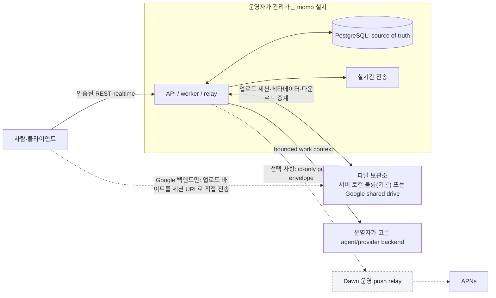

# oort 보안 판단 자료

이 문서는 조직이 oort를 도입할지 판단할 때 읽는, 구현과 결정 기록에 연결된 한국어 자료다. 취약점 신고 절차와 지원 범위는 영문 [Security Policy](../../SECURITY.md)를 따른다. 여기서 말하는 경계는 현재 저장소의 코드와 ADR에 근거하며, 인증·심사·무결함을 보증하지 않는다.

**읽는 규칙.** 줄 번호는 `track/engine` `6b786885f` 위에서 2026-10-22에 쓴 것이라 코드가 바뀌면 어긋난다. 그래서 가능한 곳에는 함수·시험 이름을 함께 적었다. 시험 이름 뒤의 (PG)는 격리 PostgreSQL이 필요한 `#[ignore]` 시험이다. 공개 PR CI의 「Security pack」 잡은 `infra/security-pack/selection.txt`에 적힌 타깃만 돌리고, 나머지는 야간 워크플로나 수동 실행이다. 사람이 격리 PostgreSQL에 대해 `cargo test … -- --ignored`로 돌리고(대부분의 시험 파일 머리말에 실행 명령이 있다) 결과는 그 시험을 건드린 PR 본문에 남긴다. 일부 묶음만 `scripts/verify_*.sh`나 로컬 게이트 프로파일이 따로 돌린다. (스크립트)는 `scripts/tests/`의 셸·파이썬 시험으로, 로컬 게이트의 docs 프로파일이 돌린다. 표시가 없는 시험은 PR CI의 `cargo test --workspace`·vitest·jest가 돌리는 단위 시험이다. `docs/security/claims.yaml`의 주장↔시험 매핑을 검사하는 린트(`scripts/check_security_claims.py`)는 현재 관리자의 로컬 게이트에서만 강제되고 공개 PR CI에는 아직 없다(후속 편입 예정).

## 신뢰 경계



실선은 oort 설치가 처리하는 경로이고, 점선은 선택 경로다. 점선은 Google 보관소를 골랐을 때의 직접 업로드, 그리고 Dawn이 운영하는 push relay다. 셀프호스트 설치에서 API·DB·realtime·agent 실행·파일 요청은 Dawn을 통과하지 않는다. relay가 받는 것은 서버·워크스페이스·기기·channel·message·thread·approval 식별자, 중복 제거 키(`collapse_id`), APNs 라우팅 정보, badge 수, `reason`·`category` 같은 닫힌 어휘뿐이며 본문·prompt·첨부는 포함하지 않는다. relay를 등록하지 않으면 push만 쓸 수 없고 oort 자체는 계속 쓸 수 있다. [근거: ADR-0120 D1·D2 17–25행](../adr/0120-push-notification-boundary.md#L17-L25), [`PushDispatch`의 닫힌 필드 집합](../../server-rust/crates/momo-push/src/dispatch.rs#L178-L196)과 이를 고정하는 시험 `dispatch_payload_is_id_only`·`dispatch_payload_has_no_content_shaped_key`·`dispatch_payload_cannot_carry_message_content`([`dispatch.rs` 324–413행](../../server-rust/crates/momo-push/src/dispatch.rs#L324-L413)), push 발송 루프는 바이너리·compose의 기본값이 꺼짐이고 Railway 템플릿은 켠다([`docker-entrypoint.sh` 36–41행](../../server-rust/docker-entrypoint.sh#L36-L41), [`momo-notifier` `config.rs` 321행](../../server-rust/bins/momo-notifier/src/config.rs#L321), [`docker-compose.rust.yml` 665행](../../infra/rust/docker-compose.rust.yml#L665), [`railway.json` 184행](../../infra/railway/railway.json#L184)), [README 「What never leaves your server」](../../README.md#what-never-leaves-your-server)

외부 agent/provider는 별도 신뢰 경계다. oort는 제한된 작업 컨텍스트를 해당 backend로 직접 보내며 Dawn을 경유하지 않는다. 구독 로그인(ChatGPT/Codex, Claude)은 운영자의 Hermes가 자기 볼륨에 보관하고, oort가 DB에 두는 provider 자격은 봉인된 암호문뿐이다. 자세한 것은 아래 「자격증명과 provider」다. [근거: ADR-0004 Boundary 표 22–33행](../adr/0004-codex-oauth-hermes-provider-boundary.md#L22-L33), [증보 6 350–359행](../adr/0004-codex-oauth-hermes-provider-boundary.md#L350-L359)

## 적용된 통제

### 테넌트 격리와 DB 역할

워크스페이스 행은 PostgreSQL RLS를 `ENABLE`과 `FORCE`로 켜고, 최초 15개 테이블의 정책은 `app.workspace_id`와 일치하는 행만 읽기·쓰기를 허용한다. 즉 이 경계는 애플리케이션 조건문만이 아니라 데이터베이스 정책으로도 집행된다. [근거: migration 001 381–400행](../../server/Migrations/001_init.sql#L381-L400) 이후 테이블의 정책도 `app.workspace_id`를 참조하지만(아래 측정), 일부에는 좁은 GUC 예외가 더 붙는다. 예를 들어 워크스페이스를 알기 전에 웹훅 서명을 검증해야 하는 `github_app_installation`은 `app.github_ingress`·`app.github_app_admin`이 켜진 트랜잭션에도 열려 있고, 인스턴스 전역 `provider_link`의 정책은 `app.provider_link_admin`이 켜진 운영자 트랜잭션에만 행을 열어 준다. [근거: migration 140 129–150행](../../server/Migrations/140_github_app.sql#L129-L150), [039 66행](../../server/Migrations/039_provider_link.sql#L66) 테넌트 트랜잭션은 시작할 때 `SELECT set_config('app.workspace_id', $1, true)`를 실행한다. `is_local = true`라 `SET LOCAL`과 같아서 커밋·롤백 때 풀린다. [근거: `tenant.rs` 1–7행](../../server-rust/crates/momo-db/src/tenant.rs#L1-L7) · [24–33행](../../server-rust/crates/momo-db/src/tenant.rs#L24-L33) · 시험 `with_tenant_tx_sets_the_rls_guc` (PG, [`conformance_pg.rs` 274–297행](../../server-rust/crates/momo-db/tests/conformance_pg.rs#L274-L297))

**측정 (사람이 돌린 것, 저장소 시험이 아니다).** 2026-10-22 `6b786885f`에서 격리 PostgreSQL 18에 `server/Migrations` 144개를 적용하고 카탈로그를 조회했다. `workspace_id` 컬럼이 있는 공개 테이블 124개 전부가 RLS `ENABLE`·`FORCE`이고 `app.workspace_id`를 참조하는 정책을 가졌다(위반 0). RLS가 없는 공개 테이블은 `workspace_id`가 없는 `plugin_registry`(전역 카탈로그), `schema_migrations`, `work_cloud_host_transition` 3개였다. 아래 질의가 0행이면 같은 결과다. 질의는 소유자나 슈퍼유저로 돌려야 한다. `information_schema.columns`는 현재 역할이 접근할 수 있는 컬럼만 보여 주기 때문이다([PostgreSQL 문서](https://www.postgresql.org/docs/18/infoschema-columns.html)). 표를 일부러 깨 본 결과(RLS 없음 · `ENABLE`만 · 정책 없음 · `app.workspace_id`를 안 쓰는 정책)에서는 질의가 그 표를 돌려줬고 올바른 표는 돌려주지 않았다.

```sql
SELECT c.relname
  FROM pg_class c
  JOIN pg_namespace n ON n.oid = c.relnamespace
 WHERE n.nspname = 'public' AND c.relkind IN ('r', 'p')
   AND EXISTS (SELECT 1 FROM information_schema.columns k
                WHERE k.table_schema = 'public' AND k.table_name = c.relname
                  AND k.column_name = 'workspace_id')
   AND (NOT c.relrowsecurity
        OR NOT c.relforcerowsecurity
        OR NOT EXISTS (SELECT 1 FROM pg_policies p
                        WHERE p.schemaname = 'public' AND p.tablename = c.relname
                          AND coalesce(p.qual, '') || coalesce(p.with_check, '')
                              LIKE '%app.workspace_id%'))
 ORDER BY 1;
```

저장소에 커밋된 시험은 이보다 좁다. 카탈로그 시험은 FORCE 테이블 수의 **하한 30**만 단정하고([`conformance_pg.rs` 142–152행](../../server-rust/crates/momo-db/tests/conformance_pg.rs#L142-L152), (PG)), `scripts/verify_rls.sh`는 이름을 지정한 7개 테이블의 FORCE와 두 워크스페이스 사이의 교차 읽기 거부를 단정한다([`verify_rls.sh` 133–148행](../../scripts/verify_rls.sh#L133-L148) · [418–513행](../../scripts/verify_rls.sh#L418-L513), 로컬 게이트 [`local_gate.sh` 775행](../../scripts/local_gate.sh#L775)). 기능별 PG 시험 몇 개는 자기 표의 FORCE를 따로 단정한다([`mem_schema_conformance_pg.rs` 885–889행](../../server-rust/bins/momo-server/tests/mem_schema_conformance_pg.rs#L885-L889), [`cloud_box_pg.rs` 772–776행](../../server-rust/bins/momo-server/tests/cloud_box_pg.rs#L772-L776)). 테넌트 테이블 전수를 단정하는 시험은 아직 없다.

DB 역할은 소유자 `momo`(스키마를 만들고 마이그레이션을 돌리는 계정)와 런타임 로그인 역할 4개다. API는 `momo_app`(`NOSUPERUSER NOBYPASSRLS`)으로 접속한다. 여러 테넌트를 훑어야 하는 배경 소비자 세 개, 곧 `momo_relay`(outbox 릴레이)·`momo_worker`(에이전트 작업)·`momo_notifier`(T3 수명주기·푸시 발송)는 `NOSUPERUSER BYPASSRLS`다. 셀프호스트 스택이 만드는 역할 중 RLS 우회는 이 세 역할뿐이고 의도된 것이다. 소유자 `momo`는 DB 슈퍼유저이지만 일회성 `runtime-roles`·`migrate` 서비스만 이 역할로 접속하고, 상시 서비스는 위 역할 중 하나로 접속한다. 마이그레이션이 더하는 보조 역할 `mem_definer`·`momo_memory`·`momo_helper_read`·`momo_sched_definer`(예약 메시지 만기 목록 함수의 소유자, 본문 열 권한 없음)는 `NOLOGIN`·`NOBYPASSRLS`다. `momo_platform_admin`(`BYPASSRLS` 읽기 전용)은 ADR-0118·검증 스크립트·`IF EXISTS` 가드에 이름만 나오고 스택은 이 역할을 만들지 않는다. [근거: `bootstrap_runtime_roles.sql` 30–44행](../../infra/rust/sql/bootstrap_runtime_roles.sql#L30-L44), [migration 100 76–86행](../../server/Migrations/100_mem_digest.sql#L76-L86) · [138 125–127행](../../server/Migrations/138_team_ai_helper_v2.sql#L125-L127) · [145 `momo_sched_definer`](../../server/Migrations/145_scheduled_message.sql), [ADR-0118 25행](../adr/0118-workspace-identity-and-rename-boundary.md#L25) · [`verify_platform_admin.sh` 154–156행](../../scripts/verify_platform_admin.sh#L154-L156) · [migration 009 56–58행](../../server/Migrations/009_workspace_tenant_rls.sql#L56-L58) API URL은 compose가 `MOMO_APP_DATABASE_URL`에서 받고, 셀프호스트 생성기는 마이그레이션 URL을 소유자 `momo`로, API URL을 `momo_app`으로 만든다. [근거: `docker-compose.rust.yml` 264행](../../infra/rust/docker-compose.rust.yml#L264), [`self_host_env.sh` 2401행](../../scripts/self_host_env.sh#L2401) · [2410–2412행](../../scripts/self_host_env.sh#L2410-L2412)

**역할 자세는 배포 시점에 검사하고, API가 기동할 때 스스로 검사하지는 않는다.** 셀프호스트 compose는 `runtime-roles` 서비스로 역할을 먼저 만들고, `migrate` 서비스는 `MOMO_BOOTSTRAP_RUNTIME_ROLES=0`으로 돈다. 그러면 `momo-migrate`는 네 역할이 정확한 자세(로그인 가능, 슈퍼유저·DB 생성·롤 생성·복제 권한 없음, `momo_app`만 `NOBYPASSRLS`, 나머지는 `BYPASSRLS`)로 있지 않을 때 마이그레이션을 거부한다. 프로비저닝 SQL도 그 자세가 아니면 예외를 던진다. API·relay·webhook sender·agent worker는 `migrate`가 성공으로 끝난 뒤에만 시작한다. [근거: `docker-compose.rust.yml` runtime-roles 156–173행](../../infra/rust/docker-compose.rust.yml#L156-L173) · [migrate 175–195행](../../infra/rust/docker-compose.rust.yml#L175-L195) · [api 445–446행](../../infra/rust/docker-compose.rust.yml#L445-L446) · [relay 481–482행](../../infra/rust/docker-compose.rust.yml#L481-L482) · [webhook-sender 536–537행](../../infra/rust/docker-compose.rust.yml#L536-L537) · [agent-worker 571–572행](../../infra/rust/docker-compose.rust.yml#L571-L572), [`momo-migrate` `ROLE_CONTRACT_SQL` 73–78행](../../server-rust/bins/momo-migrate/src/main.rs#L73-L78) · [거부 370–397행](../../server-rust/bins/momo-migrate/src/main.rs#L370-L397) · [호출 480–490행](../../server-rust/bins/momo-migrate/src/main.rs#L480-L490), [`bootstrap_runtime_roles.sql` 506–517행](../../infra/rust/sql/bootstrap_runtime_roles.sql#L506-L517) 운영자가 `scripts/oort doctor`를 돌리면 env 파일의 API URL 사용자가 `momo_app`이 아니거나 비밀번호가 맞지 않을 때 blocker로 보고한다(env 파일의 글자를 비교할 뿐 실제 접속 역할을 조회하지는 않는다). [근거: `oort_doctor.sh` 672–713행](../../scripts/lib/oort_doctor.sh#L672-L713) · 시험 `test_oort_doctor.sh`의 비밀번호 불일치 사례 (스크립트, [477–490행](../../scripts/tests/test_oort_doctor.sh#L477-L490)) 반면 API의 요청 풀이 연결 직후 `current_user`를 확인하는 부팅 가드는 Rust 서버에 없다. 요청 풀을 만드는 `crates/momo-db/src`에서 `current_user`·`rolbypassrls`·`rolsuper`를 검색하면 결과가 없다. RLS를 우회하는 역할로는 돌면 안 되는 정리·이행 작업은 가드 함수(`ensure_write_pool_rls_bound`·`ensure_rls_enforced`·`assert_least_privilege_role`)로 자기 풀의 역할을 확인하고 거부한다. API 프로세스 안에서는 예약 메시지 틱(ADR-0208)이 같은 확인을 한다. 자기 2연결 풀의 역할이 슈퍼유저이거나 `BYPASSRLS`이면 틱을 돌리지 않고 예약 접수도 닫아 생성·수정·지금 보내기가 503 `scheduler_disabled`를 답한다(목록·삭제는 된다). [근거: `scheduler.rs` `ensure_write_pool_rls_bound`·`start`](../../server-rust/bins/momo-server/src/scheduler.rs) [근거: `avatar_reclaim.rs` 260–276행](../../server-rust/crates/momo-messaging/src/avatar_reclaim.rs#L260-L276), [`huddle_sweep.rs` 104–121행](../../server-rust/crates/momo-messaging/src/huddle_sweep.rs#L104-L121), [`subscription_transition.rs` 859–877행](../../server-rust/crates/momo-agent/src/subscription_transition.rs#L859-L877)

### 기동 시 설정 검사

`momo-server`는 설정이 안전하지 않으면 기동을 거부한다(`ConfigError::InvalidSecurity`, webhook 키 누락은 `ConfigError::MissingWebhookMasterKey`). `MOMO_ENV`가 `staging`·`prod`·`production`·`internal-host`인데 실시간 프록시 비밀 `CENT_PROXY_SECRET`이 없거나 자리표시 값이면 거부한다(시험 `a_placeholder_proxy_secret_is_a_boot_error_only_in_strict_environments`). `PROVIDER_LINK_MASTER_KEY`가 `JWT_HMAC`이나 webhook 마스터 키와 같으면 거부한다(시험 `the_provider_master_key_may_reuse_neither_webhook_key`). `GITHUB_APP_MASTER_KEY`가 다른 루트 키와 같으면 거부한다(시험 `the_github_app_master_key_may_reuse_no_other_root`). webhook 마스터 키가 없거나(시험 `a_webhook_master_key_has_no_fallback_and_an_absent_one_refuses_the_boot`) 둘이 같은 값이면(시험 `two_rotated_webhook_keys_that_landed_on_one_value_refuse_the_boot`) 거부한다. 단 둘 다 옛 JWT 비밀의 복사본이면 경고만 남기고 기동한다(시험 `the_d2a_migration_window_boots_and_says_so_without_naming_a_value`). 메모리에만 저장하는 `stub` 보관소를 배포 환경에서 고르면 거부한다(시험 `a_stub_archive_is_a_boot_error_only_in_deployed_environments`). `PROVIDER_LINK_MASTER_KEY`가 없으면 기동은 하지만 `/v1/provider/link` 계열이 503으로 닫힌다. [근거: `config.rs` 설정 검사 연쇄 2304–2370행](../../server-rust/bins/momo-server/src/config.rs#L2304-L2370) · [프록시 비밀 1580–1599행](../../server-rust/bins/momo-server/src/config.rs#L1580-L1599) · [환경 판정 1985–1990행](../../server-rust/bins/momo-server/src/config.rs#L1985-L1990) · [provider 키 재사용 1881–1908행](../../server-rust/bins/momo-server/src/config.rs#L1881-L1908) · [GitHub App 키 재사용 1936–1960행](../../server-rust/bins/momo-server/src/config.rs#L1936-L1960) · [webhook 키 누락 2162–2174행](../../server-rust/bins/momo-server/src/config.rs#L2162-L2174), 시험 위치 [2962행](../../server-rust/bins/momo-server/src/config.rs#L2962) · [3165행](../../server-rust/bins/momo-server/src/config.rs#L3165) · [3463행](../../server-rust/bins/momo-server/src/config.rs#L3463) · [3558행](../../server-rust/bins/momo-server/src/config.rs#L3558) · [3569행](../../server-rust/bins/momo-server/src/config.rs#L3569) · [3596행](../../server-rust/bins/momo-server/src/config.rs#L3596)

### 감사 기록

감사 기록 도우미(`write_audit`)는 호출한 테넌트 트랜잭션 안에서 행을 써서, 행동이 롤백되면 감사 행도 함께 사라진다. 첨부의 시작·완료·실패 기록이 그 예다(아래 「첨부」). [근거: `audit.rs` 1–9행](../../server-rust/crates/momo-db/src/audit.rs#L1-L9) 감사 행을 관리자가 REST로 읽는 경로는 없다(아래 「현재 한계」).

### 자격증명과 provider

oort가 모델 provider 자격증명을 어디에 두는지는 종류마다 다르다. [근거: ADR-0004 본문 6–20행](../adr/0004-codex-oauth-hermes-provider-boundary.md#L6-L20) · [증보 1 137–147행](../adr/0004-codex-oauth-hermes-provider-boundary.md#L137-L147) · [증보 5 D5 327–338행](../adr/0004-codex-oauth-hermes-provider-boundary.md#L327-L338) · [증보 6 350–359행](../adr/0004-codex-oauth-hermes-provider-boundary.md#L350-L359) · [증보 7 360–371행](../adr/0004-codex-oauth-hermes-provider-boundary.md#L360-L371), [ADR-0147 증보 2026-09-26 37–49행](../adr/0147-chat-agent-oauth-provider.md#L37-L49) · [2026-10-03 172–199행](../adr/0147-chat-agent-oauth-provider.md#L172-L199) · [2026-10-19 255–264행](../adr/0147-chat-agent-oauth-provider.md#L255-L264)

- **API 키와 Hermes bearer.** 운영자가 설정에서 넣은 팀 키(`provider_link`·`provider_link_chain`)와 운영자가 한 사람에게 발급한 개인 키(`personal_provider_link`)는 `bytea` 칸에 AES-256-GCM 암호문으로 저장하고 평문 칸은 없다. 개인 키는 재사용을 찾는 키 지문(HMAC-SHA256, 마스터 키 사용)도 함께 둔다([migration 117 40–41행](../../server/Migrations/117_personal_provider_link.sql#L40-L41), [`personal_link.rs` 44–52행](../../server-rust/crates/momo-settings/src/personal_link.rs#L44-L52)). 암호 키는 `SHA-256("momo.provider_link.key.v1\n" ‖ 마스터 키)`이고 nonce는 봉인할 때마다 새로 만든다. [근거: `crypto.rs` 47–52행](../../server-rust/crates/momo-settings/src/crypto.rs#L47-L52) · [59–74행](../../server-rust/crates/momo-settings/src/crypto.rs#L59-L74), [migration 039 32행](../../server/Migrations/039_provider_link.sql#L32) · [042 50행](../../server/Migrations/042_provider_link_chain.sql#L50) · [117 39행](../../server/Migrations/117_personal_provider_link.sql#L39) · 시험 `a_sealed_bearer_round_trips_under_its_own_master_key`·`another_master_key_cannot_open_the_box`·`a_flipped_byte_fails_authentication`·`the_nonce_is_fresh_on_every_seal` ([`crypto.rs` 122–200행](../../server-rust/crates/momo-settings/src/crypto.rs#L122-L200)) 마스터 키 `PROVIDER_LINK_MASTER_KEY`는 JWT 비밀이나 webhook 마스터 키와 같은 값을 쓰면 서버가 기동을 거부하고(위 「기동 시 설정 검사」), 없으면 이 표면이 닫힌다.
- **응답에 나오는 것.** 팀 링크 응답은 키의 마지막 4글자까지만 싣고(8자 미만이면 없음) 개인 키는 쓰기 전용이다. [근거: `crypto.rs` 101–115행](../../server-rust/crates/momo-settings/src/crypto.rs#L101-L115), `provider_link.rs` [194행](../../server-rust/bins/momo-server/src/routes/provider_link.rs#L194) · [345행](../../server-rust/bins/momo-server/src/routes/provider_link.rs#L345) · [376행](../../server-rust/bins/momo-server/src/routes/provider_link.rs#L376), [`personal_links.rs` 19–22행](../../server-rust/bins/momo-server/src/routes/personal_links.rs#L19-L22) provider가 오류 본문에 받은 키를 되돌려 보내도 그 키는 저장된 행과 TRACE 로그에 남지 않는다 — 시험 `anth_3_the_key_never_reaches_a_durable_row_even_when_echoed` (PG, [`anthropic_adapter_conformance_pg.rs` 817–875행](../../server-rust/bins/momo-agent-worker/tests/anthropic_adapter_conformance_pg.rs#L817-L875)). 운영자 bearer도 행·메시지·오류에 남지 않는다 — 시험 `b51_4_the_operators_bearer_never_reaches_a_row_a_message_or_an_error` (PG, [`agent_worker_conformance_pg.rs` 860행](../../server-rust/bins/momo-agent-worker/tests/agent_worker_conformance_pg.rs#L860)). provider가 오류에 개인 키를 되돌려 보내도 `audit_log`·`message`·`agent_run`·`outbox`·`usage_ledger` 어느 행에도 키·키 지문·봉인 상자가 남지 않는다 — 시험 `no_row_carries_the_key` (PG, [`personal_key_conformance_pg.rs` 838–906행](../../server-rust/bins/momo-agent-worker/tests/personal_key_conformance_pg.rs#L838-L906)).
- **환경변수로 준 bearer.** 운영자가 `HERMES_API_KEY` 같은 환경변수로 준 bearer는 운영자의 환경에서 읽어 쓰며, DB 링크가 있으면 DB 쪽이 우선한다. 그 보호 수준은 그 환경의 것이다. [근거: ADR-0004 Boundary 표 30행](../adr/0004-codex-oauth-hermes-provider-boundary.md#L30) · [증보 1 D4 151–152행](../adr/0004-codex-oauth-hermes-provider-boundary.md#L151-L152)
- **구독 로그인(ChatGPT/Codex, Claude).** 이 토큰은 운영자가 호스팅하는 Hermes가 자기 볼륨에 보관하거나, 멤버가 자기 기기의 공식 CLI에 로그인한 채로 그 기기에 남는다([ADR-0147 증보 2026-09-26 37–49행](../adr/0147-chat-agent-oauth-provider.md#L37-L49)). oort 서버·API·에이전트 워커·`provider_link` 금고·DB·로그·감사는 구독 토큰(access·refresh)을 받지도 저장하지도 중개하지도 기록하지도 않는 것이 결정이다. [근거: ADR-0004 증보 6 350–359행](../adr/0004-codex-oauth-hermes-provider-boundary.md#L350-L359), [ADR-0147 증보 2026-10-19 255–264행](../adr/0147-chat-agent-oauth-provider.md#L255-L264) 코드에서 확인되는 것은 이렇다. 새 `auth.json`(`oauth-openai`) 링크는 어느 표면에서도 만들 수 없고(시험 `a_new_oauth_link_is_refused`), 개인 키 발급은 자격 봉투(`oauth-openai` 형식)를 거부하며, 개인 키 턴은 구독 OAuth 봉투를 읽으면 답하지 않는다(시험 `an_unreadable_or_non_api_key_credential_refuses` (PG)). [근거: `provider_link.rs` 263–269행](../../server-rust/bins/momo-server/src/routes/provider_link.rs#L263-L269) · [시험 1059행](../../server-rust/bins/momo-server/src/routes/provider_link.rs#L1059), [`personal_links.rs` 129–131행](../../server-rust/bins/momo-server/src/routes/personal_links.rs#L129-L131), [`personal_key_conformance_pg.rs` 771행](../../server-rust/bins/momo-agent-worker/tests/personal_key_conformance_pg.rs#L771) **예외 하나가 남아 있다.** 이 금지가 생기기 전(2026-09-27 이전)에 만든 `oauth-openai` 링크는 그 인스턴스의 금고에 봉인된 채 남을 수 있고, 에이전트 워커가 계속 갱신하고 다시 봉인한다. 읽고 지우는 것은 가능하다. [근거: `provider_link.rs` 263–266행 주석](../../server-rust/bins/momo-server/src/routes/provider_link.rs#L263-L266), [`oauth.rs` 1–30행](../../server-rust/crates/momo-settings/src/oauth.rs#L1-L30)
- **일회용 로그인 코드.** 운영자 전용 로그인 중계는 일회용 코드를 oort를 거쳐 한 번만 통과시킨다. 붙여넣기 방식에서는 운영자가 붙여 넣은 인가 코드가 Hermes 로그인 사이드카로 가고, 기기 방식에서는 사이드카가 만든 기기 코드와 인가 URL이 시작 응답으로 운영자 화면에 돌아온다. oort는 이를 저장·로그·감사·오류 응답·푸시·실시간 발행에 쓰지 않고, 토큰은 이 경로로 오지 않는다. 키(`HERMES_LOGIN_RELAY_URL`·`HERMES_LOGIN_RELAY_KEY`)가 없으면 꺼져 `409 login_relay_off`다. [근거: `login_relay.rs` 1–30행](../../server-rust/bins/momo-server/src/routes/login_relay.rs#L1-L30), 사이드카 [`login_relay.py` 10–17행](../../infra/hermes/login_relay.py#L10-L17) · [476–481행](../../infra/hermes/login_relay.py#L476-L481), [`StartReply` 133–139행](../../server-rust/crates/momo-provider-probe/src/login_relay.rs#L133-L139), [ADR-0004 증보 7 360–371행](../adr/0004-codex-oauth-hermes-provider-boundary.md#L360-L371) · 시험 `markers_never_cross_oort_in_any_channel` (PG, [`login_relay_conformance_pg.rs` 790행](../../server-rust/bins/momo-server/tests/login_relay_conformance_pg.rs#L790)): 표식 코드와 모의 토큰이 모든 응답 본문·TRACE 로그·모든 테이블 덤프·감사 행에 0번 나타난다(기기 코드와 인가 URL은 시작 응답에만 있다).

### 첨부

첨부 바이트는 Postgres가 아니라 보관소에 둔다. 보관소 백엔드는 셀프호스트 기본값인 서버 로컬 볼륨(`local`), 운영자가 지정한 Google 공유 드라이브(`google`), 메모리에만 두는 `stub`(배포 환경에서는 기동이 거부된다)이다. S3 호환 보관소는 Rust 서버에 없다. [근거: `momo-drive/src/lib.rs` 470–504행](../../server-rust/crates/momo-drive/src/lib.rs#L470-L504), [`SELF_HOST.md` 674–686행](../SELF_HOST.md#L674-L686), [ADR-0169 결정 3 17행](../adr/0169-selfhost-local-drive-archive.md#L17), [`attachments.rs` 「unported S3 client」 주석 27–29행](../../server-rust/bins/momo-server/src/routes/attachments.rs#L27-L29)

업로드 경로는 백엔드에 따라 다르다. Google 백엔드에서는 서버가 Drive 재개 가능 업로드 세션 URL을 그대로 돌려주고(시험 `drive_same_origin_does_not_rewrite_a_google_capability_url`) 클라이언트가 바이트를 Drive로 직접 보낸다. 로컬 백엔드에서는 업로드 URL이 같은 서버의 일회용·기한 있는 PUT 경로를 가리키므로 바이트가 oort 서버를 지나 로컬 볼륨에 쓰인다. 다운로드는 어느 백엔드든 서버가 멤버십을 확인한 뒤 바이트를 읽어 전달한다. [근거: `attachments.rs` 13–20행](../../server-rust/bins/momo-server/src/routes/attachments.rs#L13-L20) · [405–434행](../../server-rust/bins/momo-server/src/routes/attachments.rs#L405-L434), [`realtime_advert.rs` 207–229행](../../server-rust/bins/momo-server/src/realtime_advert.rs#L207-L229) · [시험 731행](../../server-rust/bins/momo-server/src/realtime_advert.rs#L731), [`local.rs` 1–14행](../../server-rust/crates/momo-drive/src/local.rs#L1-L14) · 시험 `the_local_archive_round_trips_session_put_complete_content` (PG, [`attachment_conformance_pg.rs` 1767행](../../server-rust/bins/momo-server/tests/attachment_conformance_pg.rs#L1767))·`an_expired_upload_url_is_refused_by_both_archives` (PG, [2380행](../../server-rust/bins/momo-server/tests/attachment_conformance_pg.rs#L2380))

oort는 세션을 만들기 전에 채널 멤버십을 확인하고, 세션을 만든 뒤 커밋하기 전에 한 번 더 확인한다. 그 트랜잭션에서 `pending` 행과 감사 기록 `attachment.upload_started`를 함께 만든다. 완료할 때는 보관소가 보고한 MIME·file ID를 요청 때 저장한 값과 대조하고, 선언한 크기가 0이 아니면 크기도 대조한다(0은 「모름」). 어긋나면 `failed`로 기록하며(감사 `attachment.upload_failed`) 409를, 보관소가 잰 크기가 상한을 넘으면 `failed`를 기록한 뒤 413을 돌려준다. 상한은 100 MiB(`MAX_ATTACHMENT_BYTES`)다. Google 백엔드는 바이트가 oort를 지나지 않으므로 상한은 업로드 도중이 아니라 선언·완료·읽기 때 적용된다. [근거: `attachments.rs` 126–166행](../../server-rust/bins/momo-server/src/routes/attachments.rs#L126-L166) · [257–265행](../../server-rust/bins/momo-server/src/routes/attachments.rs#L257-L265) · [322–330행](../../server-rust/bins/momo-server/src/routes/attachments.rs#L322-L330), [`momo-drive/src/lib.rs` 63행](../../server-rust/crates/momo-drive/src/lib.rs#L63), `attachment.rs` [267행](../../server-rust/crates/momo-messaging/src/attachment.rs#L267) · [394–396행](../../server-rust/crates/momo-messaging/src/attachment.rs#L394-L396) · 시험 `the_three_routes_round_trip_and_bind_to_a_message` (PG, [`attachment_conformance_pg.rs` 368행](../../server-rust/bins/momo-server/tests/attachment_conformance_pg.rs#L368))·`an_archived_file_that_contradicts_its_declaration_fails_and_stays_unattachable` (PG, [820행](../../server-rust/bins/momo-server/tests/attachment_conformance_pg.rs#L820))·`a_malformed_declaration_never_reaches_the_archive` (PG, [1645행](../../server-rust/bins/momo-server/tests/attachment_conformance_pg.rs#L1645))

첨부 content 조회는 같은 workspace의 archived 되지 않은 채널에 속한 active member만 통과하고, 그중에서도 **메시지에 묶인 첨부**이거나 **읽는 사람이 업로더 본인**인 첨부만 읽힌다. 아직 어떤 메시지에도 묶이지 않은 첨부(컴포저에 올려 둔 초안, 예약 메시지가 마감 시각까지 쥔 파일)는 업로더만 읽고, 다른 멤버가 요청하면 없는 id와 같은 404를 받는다. 역할(워크스페이스 owner·admin)에 따른 예외는 코드에 없다(코드 독해로 확인했고, owner·admin 계정으로 따로 시험하지는 않았다). 이 content 응답으로는 남의 초안이 있다는 사실이 드러나지 않는다. 다만 첨부 id를 이미 아는 사람이 그 id로 메시지를 보내 보면 403·409·404로 갈리는 기존 동작은 이 규칙 밖에 있다. 삭제된 메시지에 묶인 첨부는 아무도 읽지 못한다. 작성자이자 업로더인 사람도, 워크스페이스 admin도 예외가 아니고(admin은 시험에서 따로 확인했다), 응답은 없는 id와 바이트까지 같은 404다. 삭제된 메시지의 행(무덤)은 history에 남지만 첨부 목록은 비어 있다(채널 history·스레드·보내기 재시도의 echo·에이전트 포트의 이미지 목록). 묶이지 않은 완료 첨부는 업로드나 마지막 점유 해제 중 늦은 때부터 30일이 지나면 보관소 객체와 행을 함께 지운다. 메시지·예약 메시지·huddle 전사·같은 객체를 가진 아바타 어느 것도 쥐지 않은 파일만 지우고(첨부 id를 가리키는 곳을 전수로 확인한 표가 ADR-0151 증보 2에 있다), 30일 안의 파일과 예약이 쥔 파일은 건너뛴다. 지우는 것은 바이트를 쥔 프로세스다: Google Drive 백엔드는 notifier가, 셀프호스트와 Railway의 기본값인 `local` 볼륨은 api 프로세스가 한다. 쓰기는 모두 RLS-bound 연결의 워크스페이스별 트랜잭션이고, notifier가 교차 테넌트로 읽는 것은 워크스페이스 id뿐이다. **이 잡은 기본 꺼짐이다**: `MOMO_ATTACHMENT_RECLAIM`이 정확히 `1`일 때만 지우고, 꺼진 채로는 틱마다 지울 수 있는 파일 수와 바이트를 세어 한 줄만 로그에 남긴다. 켜기 전에 운영자는 읽기 전용 점검 SQL(`infra/rust/sql/attachment_reclaim_check.sql`)로 같은 숫자를 다른 길로 확인한다. 한계가 둘 있다. 로컬 볼륨의 api 러너는 워크스페이스를 열거할 길이 없어(그것을 위한 새 SECURITY DEFINER를 만들지 않았다) **재시작 뒤 업로드를 받은 워크스페이스만** 본다. 그 밖의 워크스페이스에 묵은 초안은 누가 올리기 전까지 바이트도 행도 그대로 남는다. 또 지운 메시지에 묶인 파일은 읽을 수는 없지만 행과 바이트가 남는다. 감사 `attachment.upload_started`에는 파일 이름을 싣지 않는다(schema v2). 이미 쓰인 v1 행의 이름은 마이그레이션 151이 지운다(감사 표에 해시 체인이나 추가 전용 장치가 없다는 것을 먼저 확인했고, 이 마이그레이션이 감사 행을 수정하는 유일한 것이다). 아바타 업로드 감사의 이름은 이 규칙 밖이다. 응답은 `Content-Disposition: attachment`·`X-Content-Type-Options: nosniff`·`Cache-Control: private, no-store`다. [근거: `load_readable_attachment_in_tx`](../../server-rust/crates/momo-messaging/src/attachment.rs), [`attachments.rs`의 `content`](../../server-rust/bins/momo-server/src/routes/attachments.rs), [ADR-0151 증보 1·2](../adr/0151-attachments-v0-drive-contract-port.md) · 시험 `a_deleted_messages_attachment_is_nobodys_to_read`·`a_deleted_messages_attachments_are_not_listed_anywhere`·`the_audit_trail_never_holds_a_file_name`·`a_held_file_is_never_reclaimed_and_a_released_one_is_a_draft_for_a_full_ttl`·`attachment_reclaim_conformance_pg`(notifier, PG)·`attachment_reclaim_local_pg`(api 프로세스의 로컬 볼륨 러너, PG)·`the_audit_scrub_removes_a_file_name_from_old_upload_rows_and_touches_nothing_else`(마이그레이션 151, PG)·`the_channel_boundary_holds_on_every_route`·`an_unbound_attachment_is_its_uploaders_alone_until_a_message_carries_it`·`a_draft_and_a_carried_attachment_stay_inside_their_tenant_and_channel`·`a_scheduled_messages_file_is_its_authors_alone_until_the_message_goes_out` (모두 PG, [`attachment_conformance_pg.rs`](../../server-rust/bins/momo-server/tests/attachment_conformance_pg.rs))

MOMO-638 migration은 `drive_file_id` 단독 unique를 `(workspace_id, drive_file_id)` partial unique로 교체했다. 같은 Drive file ID를 서로 다른 workspace가 참조해도 unique 제약으로 다른 workspace의 존재를 드러내지 않도록 한 변경이다. [근거: migration 044 4–14행](../../server/Migrations/044_attachment_drive_file_workspace_unique.sql#L4-L14), [35–39행](../../server/Migrations/044_attachment_drive_file_workspace_unique.sql#L35-L39)

### Google 보관소와 플러그인 grant

Google 백엔드는 서비스 계정이 운영자가 지정한 공유 드라이브의 구성원이 되는 방식이다. 이 백엔드가 쓰는 Google 자격은 운영자가 파일 경로로 준 서비스 계정 키 하나이고(`MOMO_DRIVE_SA_KEY_PATH`) 사용자 Google 토큰은 쓰지 않는다. Rust 서버가 직접 호출하는 Google API 주소는 `momo-drive`의 이 백엔드에만 있다(`googleapis.com` 검색에서 나머지 한 곳은 호스트 이름을 비교하는 검사다). 서비스 계정 토큰의 scope는 `drive.file`이고, 서버는 파일 메타데이터에서 `driveId`와 `trashed`를 읽어 설정된 공유 드라이브의 살아 있는 파일이 아니면 접근 거부로 처리한다. [근거: `google.rs` 3–7행](../../server-rust/crates/momo-drive/src/google.rs#L3-L7) · [21–24행](../../server-rust/crates/momo-drive/src/google.rs#L21-L24) · [55행](../../server-rust/crates/momo-drive/src/google.rs#L55) · [394–410행](../../server-rust/crates/momo-drive/src/google.rs#L394-L410), [`lib.rs` 443–451행](../../server-rust/crates/momo-drive/src/lib.rs#L443-L451) 공식 플러그인 카탈로그에는 Gmail·Google Calendar·Google Drive 「내 드라이브」(사용자 OAuth, Google 미리보기)도 있다. 서버에는 이 앱들의 매니페스트·설치·grant 기록만 있고, 사용자 OAuth 토큰과 클라이언트 값은 도구를 실행하는 호스트(Hermes의 `mcp-tokens/`, 멤버의 기기 등)에만 둔다. [근거: ADR-0113 D1 20–24행](../adr/0113-connector-credential-plugin-boundary.md#L20-L24) · [증보 2 E2 182–196행](../adr/0113-connector-credential-plugin-boundary.md#L182-L196) · [E6 265–277행](../adr/0113-connector-credential-plugin-boundary.md#L265-L277), [migration 143 머리말 1–16행](../../server/Migrations/143_official_catalog_c_s1b.sql#L1-L16)

플러그인 레지스트리는 정책 메타데이터만 담고 자격증명을 담지 않는다. grant는 `(workspace, member, plugin, scope)` 4-튜플이고 `granted_by = member_id`를 DB가 강제해서 타인이 대신 발급하는 grant를 허용하지 않는다. 쓰기 라우트는 알려진 키만 받고, 자격증명 모양의 키가 들어오면 400으로 거부하며 읽지도 저장하지도 되돌려 주지도 않는다. 카탈로그가 보여 주는 플러그인은 공식 7개뿐이다(`OFFICIAL_PLUGIN_IDS`, 시험 `the_allowlist_is_the_seven_official_plugins`). [근거: migration 013 66행](../../server/Migrations/013_plugin_registry.sql#L66), [`plugins.rs` 1–40행](../../server-rust/bins/momo-server/src/routes/plugins.rs#L1-L40) · [시험 976–979행](../../server-rust/bins/momo-server/src/routes/plugins.rs#L976-L979), [`team_ai_tools.rs` 83–91행](../../server-rust/crates/momo-workspace-actions/src/team_ai_tools.rs#L83-L91) · 시험 `a_grant_is_personal_and_needs_an_enabled_install` (PG, [`plugin_registry_write_conformance_pg.rs` 900행](../../server-rust/bins/momo-server/tests/plugin_registry_write_conformance_pg.rs#L900))·`no_credential_survives_any_request_or_response` (PG, [1601행](../../server-rust/bins/momo-server/tests/plugin_registry_write_conformance_pg.rs#L1601))·`another_workspace_never_sees_or_changes_my_rows` (PG, [1497행](../../server-rust/bins/momo-server/tests/plugin_registry_write_conformance_pg.rs#L1497))

### 배포·소스 공개

oort는 Apache-2.0이고 기여에는 DCO를 사용하며 별도 CLA를 요구하지 않는다. [근거: README 「License and contributions」](../../README.md#license-and-contributions), [CONTRIBUTING DCO 11–22행](../../CONTRIBUTING.md#L11-L22)

공개 이미지는 수동 실행(`workflow_dispatch`) 워크플로 `publish-images.yml`이 만든다. 이 워크플로는 `main`에서 실행한 경우에만 진행하고(단계 「Require a main-branch dispatch」), `release` GitHub Environment의 필수 검토자 승인을 기다리며, 아키텍처별 빌드에 buildx provenance(`mode=max`)와 SBOM을 붙이고, 각 빌드가 푸시한 digest와 마지막 manifest list digest에 `actions/attest`로 SLSA v1 provenance를 증명한다. 검증은 운영자가 직접 하는 `gh attestation verify`이고 명령은 `releases/latest.json`의 `attestation.verify_cmd`에 있으며 manifest list digest(고정할 digest)를 검증한다. 2026-10-22 실측: 그 list digest는 검증을 통과했고, 같은 파일의 `images.app.digests`(list 안의 이미지 manifest)에 같은 명령을 쓰면 404가 났다. digest 모드에서 `scripts/oort doctor`는 이미지가 digest로 고정돼 있는지와 그 명령이 있는지만 기록하고 실행하지는 않는다. [근거: `publish-images.yml` 20행](../../.github/workflows/publish-images.yml#L20) · [46–57행](../../.github/workflows/publish-images.yml#L46-L57) · [100–101행](../../.github/workflows/publish-images.yml#L100-L101) · [125–143행](../../.github/workflows/publish-images.yml#L125-L143) · [227–244행](../../.github/workflows/publish-images.yml#L227-L244) · [327–340행](../../.github/workflows/publish-images.yml#L327-L340), [`latest.json` 22–24행](../../releases/latest.json#L22-L24), [`SELF_HOST.md` 128–141행](../SELF_HOST.md#L128-L141), [`oort_doctor.sh` 799–851행](../../scripts/lib/oort_doctor.sh#L799-L851) · 시험 `scripts/tests/test_publish_images_contract.py` (스크립트, [129행 `run_ref_guard`](../../scripts/tests/test_publish_images_contract.py#L129)) · `release` Environment의 필수 검토자는 2026-10-22 `gh api repos/yeomyeonggeori/oort/environments/release`로 확인했다.

Tauri **next** 채널은 minisign 업데이트 서명과 Developer ID 서명·공증·staple 절차를 문서화한다. 공개키는 빌드에 컴파일돼 있어 서명 없는 페이로드는 설치되지 않는다. next 채널은 팀 채널이며 매니페스트와 자산은 공개 URL이다. [근거: `NEXT_CHANNEL.md` 4행](../NEXT_CHANNEL.md#L4) · [37–61행](../NEXT_CHANNEL.md#L37-L61), [`tauri.conf.json` 40–45행](../../clients/desktop/src-tauri/tauri.conf.json#L40-L45)

## 하지 않는 것

시험으로 증명할 수 없어서 주장하지 않는 것이다. 보안 주장은 [`claims.yaml`](claims.yaml)에서 증명 시험에 연결되고, 시험이 없는 문장은 공개하지 않는다([ADR-0214](../adr/0214-security-claims-need-tests.md)).

- <!-- limit:LIM-1 -->**종단 간 암호화(E2EE)가 아니다.** 서버는 메시지 내용을 읽을 수 있다. 검색·에이전트·알림 미리보기가 그 위에서 동작한다. 비교: Slack 보안 페이지도 전송 중 TLS와 저장 암호화를 설명할 뿐 종단 간 암호화를 주장하지 않는다([출처](https://slack.com/resources/why-use-slack/security-at-slack)).
- <!-- limit:LIM-2 -->**외부 보안 감사·침투 시험을 받지 않았다.** 이 문서의 근거는 관리자가 직접 돌린 시험과 그 증거다.
- <!-- limit:LIM-3 -->**SOC 2·ISO 27001 같은 인증이 없다.**
- <!-- limit:LIM-4 -->**서버 운영자는 평문 메시지와 DB를 볼 수 있다.** Zulip 보안 모델 문서도 애플리케이션·DB 서버의 root 권한자는 「메시지를 읽고 기록을 고칠 수 있다」고 적는다([출처](https://zulip.readthedocs.io/en/latest/production/security-model.html)). 신뢰할 수 있는 운영자를 고른다.

## 공개하지 않는 것

공개가 공격 지도가 되지 않도록 통제 목록·시험 이름·CI 링크·수정이 끝난 권고는 공개하고, 다음은 공개하지 않는다. 수정 전 취약점의 세부, 운영 중 인스턴스의 설정값·시크릿, 공격 단계 수준의 위협 모델(요약만), 프롬프트 인젝션 공격 코퍼스(방법·통계만), 운영 환경 스캔 결과. 정본은 ADR-0214다.

## 현재 한계와 도입 시 확인할 점

- API 프로세스는 기동할 때 자기가 어떤 DB 역할로 접속했는지 확인하지 않는다. `MOMO_APP_DATABASE_URL`을 `momo_app`이 아닌 역할로 가리켜도 서버가 막지 않고, `scripts/oort doctor`가 env 파일 기준으로 blocker로 보고할 뿐이다(위 「테넌트 격리와 DB 역할」).
- 테넌트 테이블 전수가 RLS `FORCE`이고 `app.workspace_id` 정책을 가졌다는 것은 이제 `tenant_catalog_pg` 카탈로그 시험이 표마다 단정하고 공개 PR CI의 Security pack이 매번 돌린다(주장 TEN-1~3, [`claims.yaml`](claims.yaml)). 위의 「측정」 문단은 그 시험이 생기기 전 수동 측정의 기록이다.
- 감사 행(`audit_log`)을 관리자가 목록으로 읽는 REST 경로는 Rust 서버에 없다. OpenAPI에는 `GET /v1/workspaces/{workspaceId}/audit`(`listWorkspaceAudit`)가 적혀 있지만 라우터에 등록된 핸들러가 없고 클라이언트도 부르지 않으며, ADR-0183 판정표가 이 경로를 폐기로 분류했다. [근거: `openapi.yaml` 2026–2050행](../api/openapi.yaml#L2026-L2050), [ADR-0183 판정표 audit 행 112행](../adr/0183-codebase-docs-lightening.md#L112)
- Drive 도구 호출(`tools/call`) 경로는 Rust 서버로 옮기지 않았다. 플러그인 레지스트리의 Drive 항목은 설치·grant 기록이고, 서버가 Drive 도구를 대신 실행하지는 않는다. [근거: ADR-0183 판정표 mcp 잔여 행 114행](../adr/0183-codebase-docs-lightening.md#L114)
- 첨부에는 바이러스·멀웨어 검사가 없다. 서버 코드·infra·스크립트에서 `clamav`·`antivirus`·`virus`를 검색하면 결과가 없다. MIME은 `type/subtype` 형식과 선언값·보관소 메타데이터의 일치만 확인하고 내용을 sniffing하지 않는다. [근거: `attachment.rs` 134–155행](../../server-rust/crates/momo-messaging/src/attachment.rs#L134-L155), [`attachments.rs` 253–261행](../../server-rust/bins/momo-server/src/routes/attachments.rs#L253-L261)
- 브라우저는 refresh token을 `localStorage`에 둔다. access token은 메모리에만 두고, desktop shell은 OS keychain을 쓰지만(keychain이 답하지 않으면 localStorage로 돌아간다) 브라우저 경로의 XSS 위험을 이 사실이 없애지는 않는다. [근거: `session.ts` 27–57행](../../clients/web/src/lib/session.ts#L27-L57)
- Tauri desktop shell에는 CSP가 설정돼 있고, 원격 script·font·frame·object·worker 경로를 닫는다. 다만 **`connect-src`는 의도적으로 넓다** — 접속할 서버 주소가 연결 화면에서 입력되는 런타임 값이고(HTTP LAN 서버 포함), 관전 터미널이 그와 별개인 호스트 엔드포인트를 직접 문다. 즉 이 CSP는 **주입된 스크립트가 원격 코드를 불러오는 것**을 막지, 임의 목적지로의 네트워크 연결 자체를 막지는 않는다. `style-src`의 `'unsafe-inline'`도 터미널 렌더러가 셀마다 style 속성을 쓰기 때문에 남아 있다. [근거: `tauri.conf.json` 31행](../../clients/desktop/src-tauri/tauri.conf.json#L31), [`serverBase.ts` 10–37행](../../clients/web/src/lib/serverBase.ts#L10-L37), [`serverUrl.ts` 31행](../../packages/momo-core/src/lib/serverUrl.ts#L31), [`observerStream.ts` 19–22행](../../clients/web/src/features/work/observerStream.ts#L19-L22), [`terminalRuntime.ts` 19–26행](../../clients/web/src/features/work/terminalRuntime.ts#L19-L26) · 시험 `desktopShellContract.test.ts`의 CSP 사례 ([169–183행](../../clients/web/src/app/desktopShellContract.test.ts#L169-L183))
- 이 문서는 제3자 보안 감사, 침투 테스트, SOC 2 또는 ISO 인증을 주장하지 않는다. 스토어 제출 게이트의 S-8(Enterprise Trust)은 위협 모델·VDP·펜테스트 계획·보안 백서 초안을 요구하는 항목인데 아직 체크되지 않았다. [근거: `03-store-readiness-gate.md` 113행](../cicd/03-store-readiness-gate.md#L113)
- Gmail·Google Calendar·「내 드라이브」 플러그인은 Google 미리보기 단계이고, 도구 실행과 사용자 OAuth 토큰은 oort 서버가 아니라 실행 호스트에 있다. oort 서버는 이를 대신 실행하거나 토큰을 보관하지 않는다. [근거: ADR-0113 증보 2 E2 182–196행](../adr/0113-connector-credential-plugin-boundary.md#L182-L196) · [E6 265–277행](../adr/0113-connector-credential-plugin-boundary.md#L265-L277)

## 읽는 방법

이 자료는 위협 모델이나 인증서가 아니라 현재 구현과 승인된 결정의 인덱스다. 운영 환경의 network egress, provider 선택, archive backend, secret 관리와 업데이트 채널은 조직의 정책과 함께 별도로 검토해야 한다. 취약점은 공개 이슈가 아니라 영문 [Security Policy](../../SECURITY.md#report-a-vulnerability)의 private advisory 절차로 신고한다. [근거: SECURITY 「Report a vulnerability」](../../SECURITY.md#report-a-vulnerability)
